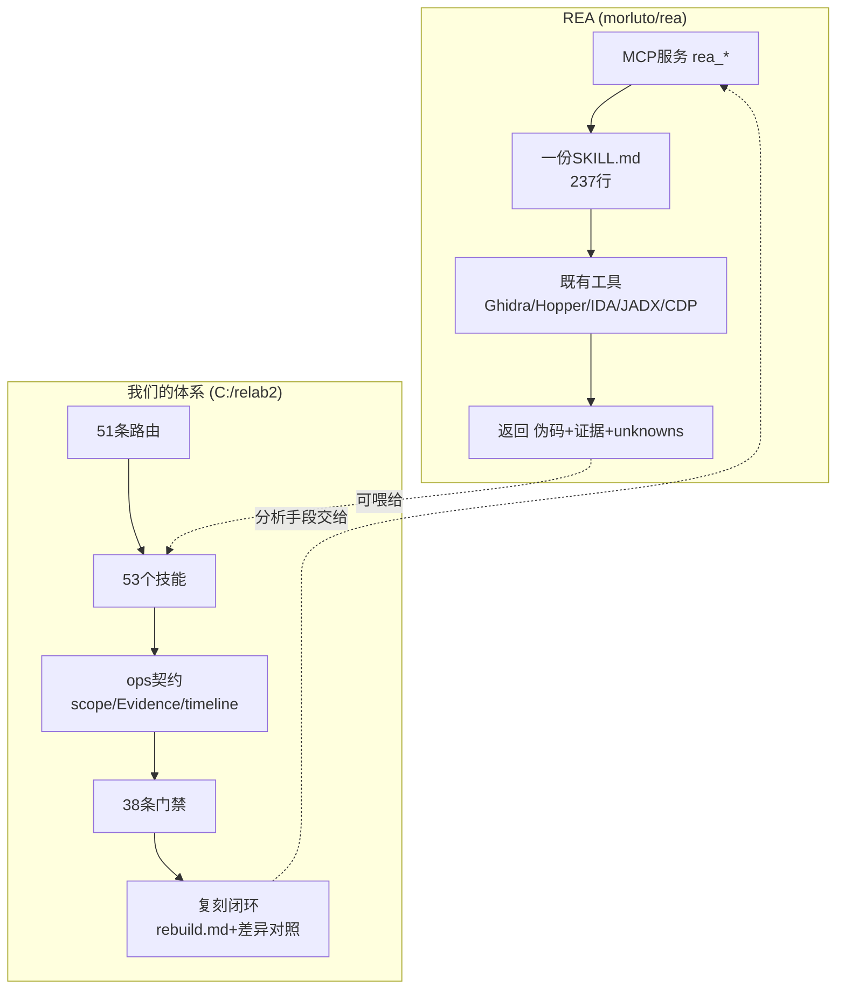

# 外部项目分析报告 · morluto/rea（REA）

> 分析日期：2026-10-13。**性质：外部项目分析，不进入本项目代码。**
> 用户指示：先不要往 `C:\relab2` 加任何东西，只出分析报告，供后续决策。
>
> **本文所有关于 REA 的陈述都有出处**：README_zh.md（301 行）、`skills/reverse-engineer-anything/SKILL.md`（237 行）、
> `.agents/skills/.../SKILL.md`（237 行）、`skill-src/.../references/evidence-workflows.md`、`docs/cli.md`（221 行）、
> `docs/native-investigation.md`（445 行）、`docs/mcp-contracts.md`、rea.tools 官网、DX-Ball/Notion/TH04 三个案例、
> mindstudio 的第三方评测、npm 元数据。
> **未能读到的**（网络超时或 DNS 失败，如实标注）：`docs/mcp-contracts.md` 正文、`docs/cli.md` 正文、
> `docs/native-investigation.md` 正文、`skill-src/references/evidence-workflows.md` 正文。
> 凡是只见标题未见正文的，本文一律标 `[未见正文]`。

---

## 0. 一句话对比

**REA 是「一个 MCP 服务 + 一份 skill」，把一堆既有逆向工具包给 agent 用；我们是「一整套工程纪律 + 路由 + 契约 + 门禁」，管的是 agent 怎么把活干完、干对、可追溯。**
两者在不同层，**几乎不重叠**。REA 强在**覆盖面与产品化程度**，我们强在**过程纪律与交付闭环**。



---

## 1. REA 到底是什么（架构拆解）

### 1.1 三层结构

| 层 | 内容 | 实测证据 |
|---|---|---|
| **分发层** | npm 包 `rea-agents`，`npx rea-agents setup` 一条命令注册到 Claude Code / Codex / Cursor / Gemini CLI / Grok Build 等 | README「快速开始」；npm 元数据：当前 6.3.0，首发 2026-07-12，0 依赖，MIT |
| **接口层** | 一个 MCP server，暴露 `rea_*` 工具族（`open_binary` / `analyze_function` / `read_bytes` / `inspect_android_package` / `inspect_managed_artifact` / `analyze_javascript_application` / `list_browser_targets` …） | SKILL.md「Route the target first」整节就是工具→目标的映射表 |
| **执行层** | 调既有工具：Ghidra、Hopper、IDA、JADX、headless JADX、Chrome DevTools、mitmdump、binwalk/unblob、pwntools、WABT | README「可以分析什么」表；SKILL.md 各条目 |

**关键设计：它自己几乎不造轮子。** mindstudio 评测说得直白：「Every tool in REA's stack predates the current AI agent wave by a decade or more. Ghidra 2019, Hopper 2011, IDA 1990s. REA adds an interface layer.」

### 1.2 它的 skill 是怎么写的（这是最值得学的部分）

`.agents/skills/reverse-engineer-anything/SKILL.md`，237 行 / 14.5 KB，结构：

1. **「Connect only when needed」**——先判断要不要连，别每次跑 setup
2. **「Route the target first」**——**按目标类型选第一个工具**，一张 20+ 行的映射表（ASAR→`analyze_javascript_application`；APK→`inspect_android_package`；托管 PE→`inspect_managed_artifact`；固件→`inspect_firmware_regions`；ELF→`inspect_binary_layout`；core dump→`inspect_recorded_crash`；WASM→`inspect_wasm_artifact`；EVM→`inspect_evm_interface`；Go→`inspect_go_binary`；PE 资源→`inspect_pe_resources`…）
3. **「Work summary-first」**——先看默认结果，别一上来就深挖

**它的 description 写得极克制**（这正是我们缺的）：

> "Reverse engineer native, managed, Electron/JavaScript, packaged, firmware, and browser targets with REA. Use shipped-artifact or requested runtime evidence to explain features, compare versions, decompile code, or guide a reconstruction. **Skip REA for ordinary source-repository architecture analysis.**"

——**明确划出「不适用」边界**。我们的 53 个技能里，只有少数几个 description 带 "Do not use it when…"。

### 1.3 它的证据观（README + 官网反复强调）

- 「Analysis runs locally, and **results include the evidence and limitations behind each conclusion**.」
- DX-Ball 案例里，反编译结果同时给 **pseudocode + instructions + callers**，并明说「That discrepancy gave the agent a concrete reason to keep investigating」——**把工具输出的内在矛盾当作继续调查的理由**，这跟我们经验卡 `gate-self-must-prove-failure` 是同向的。
- 官网 DX-Ball 页：每个结论都挂「REA result · pseudocode excerpt」「REA → agent · instruction excerpt」——**证据与结论同框**。

### 1.4 它的版本管理（这点超出我预期）

- 官网 DX-Ball：「Recorded with **REA 4.1.0** for the **hash-pinned DX-Ball 1.07** target. The linked investigation notes retain the Evidence IDs.」
- README「更新 REA」整节：`rea update` + 重跑 setup，并说「REA changes quickly, and new releases include frequent bug fixes」

**它把「我用哪个版本的工具、分析了哪个哈希的样本」当成必须记录的事实。** 这跟我们 `update.md` 设计里的版本指纹是同一件事。

---

## 2. 它的「完成度」打法：DX-Ball 案例深读

这是我认为**最值得我们学的一条**，比任何流程表都实在。

DX-Ball 1.07 → 可维护 C 版。当前进度（项目 checkpoint 2026-10-07）：

```
55     maintained C functions
45,380 comparisons with original code
33     functions with matching compiled bytes
```

三级验收，层层加严：

| 级 | 判据 | 数字 |
|---|---|---|
| L1 | 反编译出伪码 / 指令 | 每函数都有 |
| L2 | **行为等价**：执行原 x86 函数 vs 维护的 C，比返回值 | 3,205 个 case（覆盖 0–640 全部整数位置 × 5 个 pan scale: 0/0.5/1/20/−1） |
| L3 | **字节等价**：用**钉住的 VC4.0 工具链**重编译，与可执行文件里的原函数逐字节匹配 | 33 个函数、63 字节 |

**注意 L3 的含金量**：它不止说「行为一样」，而是「用原作者那个年代的编译器重编，编出来的字节和原文件一样」。这是「我真的理解了原作者怎么写」的机器判据。

这直接对上我们 `license-keygen` 的 L1–L5（L1 自洽 → L2 官方 key 回归 → L3 进程内替换 → L5 重启保持），但 DX-Ball 的 **L3 字节级 replay** 是我们没有的思路。

---

## 3. 它能做什么、我们不能做什么（覆盖面）

REA 的「可以分析什么」表（README），逐行对我们 53 个技能：

| REA 支持 | 我们有对应吗 | 谁强 |
|---|---|---|
| 原生二进制（Ghidra/Hopper/IDA 三选一） | `reverse-engineering` / `ida-reverse` / `ghidra-reverse` / `radare2` 都在 | **平**（我们工具更全：IDA 8.3 + JEB + BN + r2 + Ghidra + cdb + x64dbg MCP） |
| **离线 ELF 布局**（pwntools，不开数据库） | 无专项 | **REA** |
| **EVM 字节码** | 无 | **REA** |
| **已记录的 Linux 崩溃（core dump）** | 无（我们有 `cdb -z` 但不成体系） | **REA** |
| JS / Electron | `js-reverse` + `web-protocol-reverse` | **平**（我们的 `web-protocol-reverse` 更深：browser-free Python 采集器是终局交付） |
| 网站（CDP） | `browser-automation` + `js-reverse` | 平 |
| HAR / mitmproxy 捕获 | `protocol-reverse` + `thick-client` | 平 |
| .NET 程序集 | `dotnet-reverse`（我们的更深：de4dot/ConfuserEx/IL patch） | **我们** |
| Android APK | `apk-reverse` + `mobile-reverse` | **平偏我们**（我们有 emulator-lab 18 动作 + 真机实测） |
| Android 设备（adb） | `apk-reverse` 的 adb 链路 | 平 |
| JEB 项目（复用已开客户端） | `ida-reverse` 也有类似思路 | 平 |
| **固件**（binwalk/unblob） | `firmware-pentest`（OWASP FSTM 九阶段，更深） | **我们** |
| **包与资源**（plist / Apple bundle） | 散在各技能 | REA 成体系 |
| **进程行为捕获**（PTY，跑起来看输出/退出/文件系统） | 无专项（我们有 Procmon 经验但不成 skill） | **REA** |
| **Go 二进制内嵌元数据** | `go-rust-reverse`（pclntab 恢复，更深） | **我们** |
| WASM 工件 | `dsl-vm-reverse` 沾边 | REA 成体系 |

**结论：覆盖面 REA ≈ 我们，互有强弱。** REA 强在「每一种目标都有独立工具 + 独立 guide + 独立 skill 条目」，文档一致性极高；我们强在单个领域挖得深（固件 FSTM、.NET 脱混淆、APK 真机链路、协议→纯 Python 采集器）。

---

## 4. 我们强在哪（这是重点，别自卑）

### 4.1 交付闭环——REA 完全没有

REA 的终点是什么？看它的整个 README + 官网：

- 「explain how the feature works, **show the evidence**, and build a version for your project」
- DX-Ball 案例的 C 代码、测试、进度账（`docs/PROGRESS.md`、`docs/ORACLES.md`）——**这些全是 REA 之外的人工项目**，不是 REA 提供的机制
- 官网明说：「the **reconstruction project** implements and tests the result」

**翻译**：REA 给你零件和证据，「怎么组织成一个完整交付、怎么验收、怎么跟上游升级」是用户自己的事。
**这正是我们这一个月在建的东西**（rebuild.md 对账表 + impl/ver 角色 + review_case 交付审计 + update.md 版本更新）。

### 4.2 过程纪律

| 我们有 | REA 有吗 |
|---|---|
| scope.md 授权硬门（`-Force` 不绕过） | 无（它靠「本地运行 + 用户给路径」） |
| Evidence→Finding→Path 三层契约 | 有「evidence + unknowns」概念，但**不是结构化契约** |
| timeline / workitems / Coverage | 无 |
| 反漂移（GOAL.md + decision_delta + carry_forward_refs） | 无 |
| 38 条回归门禁 + 负控 | **有 CI**（`ci.yml`），但那是它自己的 CI，不是「任务完成度门禁」 |
| 经验卡（可判定规则 + 晋级门 + 正负 oracle） | 无 |
| 跨会话/跨阶段状态恢复 | 无（每次新对话从 SKILL.md 重新来） |

### 4.3 工具链深度

我们本机实测（`TOOL-CHAIN.md`、`环境建设.md` §6）：
`diec` / `upx` / `floss` / `capa` / `pe-sieve` / `scyllahide`（实测三层翻转）/ `cdb`（实测 API 断点 + 调用栈）/ `x64dbg` MCP（80 工具）/ `pyghidra-mcp`（20 工具）/ `idat64_83`（可用）/ `jeb` / `ilspycmd` / `dnSpy.Console` / `de4dot` / `r2` / `frida`（17.17）+ `emulator-lab`（六家模拟器）

REA 这边的原生分析要**用户自己装 Ghidra / Hopper / IDA**（setup 可在批准后装 Hopper）。

---

## 5. 它强在哪（值得学的，逐条列出）

### 5.1 「目标→工具」路由表（最该学）

它的 SKILL.md 整节就是一张**目标类型 → 第一个工具**的表，20+ 行，每个目标都带「这个工具不吃什么、需要什么前置」：
- 「ASAR or extracted JavaScript/Electron tree: `analyze_javascript_application`」
- 「Firmware image: `inspect_firmware_regions` when advertised. Use `extract_firmware` when extraction is requested, with a **caller-selected new absolute output directory**」
- 甚至写了 **fallback 判定**：「.NET NativeAOT PE/ELF: native Ghidra analysis」

我们 51 条路由是「用户嘴里的词 → 技能」，**没有「我手里这个文件 → 第一个该跑什么」的独立一层**。我们的 triage 散落在 `triage-first-30-min.md`、`signal-to-tool-decision.md`、各技能的 ACTION REQUIRED 里。

### 5.2 「summary-first」的上下文纪律

SKILL.md：「Start with the default result and use its inline Evidence and graph context. For a JavaScript application or ELF layout whose size is unknown or large, …」——**默认结果优先，别一上来深挖**。这和我们 kernel 那张卡 §9「开工先取任务包，不跑全量账本」是同向的。

### 5.3 「工具不可用就诊断并继续，别重复 setup」

SKILL.md「Connect only when needed」：「Diagnose the observed blocker, continue useful supported work, and resume the original task after repair. **Client approval, shell PATH, registration and engine availability have different remedies; avoid repeating setup for all of them.**」

——**四种失败原因四种药，别一视同仁地重跑 setup**。这条我们踩过：PATH 快照过期导致 `Get-Command` 全空、误判「本机缺工具」（`env-selfcheck.md` 记着）。REA 把它写成了 skill 条文。

### 5.4 「能力声明与安装物解耦」

SKILL.md：「a skill installed from repository main may describe capabilities absent from an older npm release. **Use the connected server's actual tool list and input schemas.**」

——**文档说的≠装的有的，以实际工具清单为准**。这是防虚构的硬条文。我们缺这条明写的规则。

### 5.5 「保留原始记录，不当结论」

SKILL.md 反复出现：
- 「Preserve raw module bytes and source ranges; **absent metadata does not prove a binary is not Go**」
- 「**WAT is not original source**」
- 「treat selectors, argument strings and mutability as **inferred candidates**; this performs no chain lookup」
- 「**Historical PIDs do not select live processes**」

——**每一条都在防「把工具的输出当成事实」**。这和我们的 ADF（R41 grounded claims / R44 single-source）同向，但 REA 写得极其具体、可执行。

### 5.6 版本与哈希钉住

「Recorded with REA 4.1.0 for the hash-pinned DX-Ball 1.07 target」——工具版本 + 样本哈希，两条都得记。我们的 `rebuild.md` 设计了 `upstream_version`，但**没要求记「分析时用的工具版本」**。

---

## 6. 能不能融合？（直接回答用户的问题）

### 6.1 结论：**不能合并成一个仓库，但可以互补;而且它更新太快，合并是负资产**

用户原话：「它这个是经常会去更新」「它里面应该有一套的东西」。

**实测它的更新频率**（npm 版本记录）：
```
6.3.0  2026-10-10    6.2.0  2026-10-09    6.1.0  2026-10-09
6.0.0  2026-10-08    5.0.0  2026-10-07    4.1.0  2026-10-06
4.0.1  2026-10-05    4.0.0  2026-10-05    3.2.1  2026-10-03
3.2.0  2026-10-03    3.1.0  2026-08-09    ...
```
**首发 2026-07-12，三个月到 6.3.0，10 月前 10 天发了 9 个版本。** 它的 README 自己说「REA changes quickly, and new releases include frequent bug fixes. Keep your installation up to date.」

**这意味着什么**：
- 把它 vendor 进我们仓库（像 `community-raw/` 那样）→ **两周就过期**，而且它的正文引用自己的 `.md` 路径，锁版本就断链
- 把它的 skill 改编进我们 → 失去 `rea update` 的更新通道，我们得手工追
- 它的 MCP 服务是 Node 包，我们这边 `skill-supply-chain.md` 要求 pin 版本/哈希——**一个三天一发的包，pin 了就等于锁死**

### 6.2 正确的结合方式：**当外部工具用，不当内部资产**

三种可行姿势，按侵入性从低到高：

| 姿势 | 做法 | 代价 |
|---|---|---|
| **A. 纯并列**（推荐先做） | 本机 `npm i -g rea-agents`，它的 MCP 注册进宿主；我们的 `routing.json` 不动。遇到我们没有的目标类型（EVM / core dump / 离线 ELF 布局 / 进程 PTY），手动切过去用 | 零维护成本，但要人记得 |
| **B. 工具登记** | 在 `TOOLS.md` / `bootstrap-manifest.json` 给它记一行「rea-agents：外部 MCP，覆盖 EVM/core/ELF-layout/PTY 四类我们没有的能力」，并在 `reverse-engineering/SKILL.md` 的下游出口加一句「这四类目标可用 rea MCP」 | 低。但要处理供应链 pin |
| **C. 新增一个 thin wrapper 技能** | `skills/community/rea-bridge/SKILL.md`，只做「什么时候该用 REA、它的工具怎么选、它的输出怎么转成我们的 Evidence 格式」 | 中。要过我们自己的门禁（frontmatter / 路由 benchmark / 负控） |

**我建议 A + B，不做 C。** 理由：C 会变成「第二个路由」，而我们的痛点恰恰是路由太多、上下文太胖。

### 6.3 但它有两样东西**必须学**（不管融不融合）

1. **「目标类型 → 第一个工具」独立路由层**。这个可以直接写进我们的 `reverse-engineering/references/signal-to-tool-decision.md`，或者更彻底——做成 `skills/references/target-first-router.md`，一句话：「拿到文件先查这张表，再决定开哪个技能」。
2. **「能力声明与安装物解耦」+「工具输出不当结论」两组硬条文**。直接进 `RULES.md` 的 Output Quality 段 + 各技能的 ACTION REQUIRED。成本几乎为零，收益直接。

---

## 7. 风险与边界（如实说）

### 7.1 REA 侧的风险

| 风险 | 依据 |
|---|---|
| **它的 hype 大于实证** | mindstudio 评测：「The hype is partly memetic. Much of the coverage leans on GitHub star growth charts rather than strong demos」；「a vanilla agent finished first in that particular race」——不用 REA 的裸 agent 反而先完成 |
| **npm 周下载量 0**（npm.io 数据） | 可能是统计口径问题（大量人用 npx），但结合上一条，说明真实使用量待考 |
| **无类型声明、CommonJS、0 依赖** | npm.io Health 55/100，警告「low downloads; no types; no esm support」 |
| **它明确不碰安装**：「REA setup never installs or upgrades unrelated software, including Node.js, npm, Homebrew, Java, Ghidra, IDA, JADX, Binwalk or Unblob」 | 所以它对本机零副作用，但也意味着**原生分析前置要用户自己满足** |
| **Windows 上 Ghidra 支持是 P0 实验性** | README 链到 `docs/windows-ghidra-p0.md`（`[未见正文]`，但文件名说得很清楚） |

### 7.2 我们如果用它的风险

| 风险 | 处置 |
|---|---|
| 供应链：一个三天九版的包 | 若要进 `bootstrap-manifest.json`，pin 到具体版本 + `assetSha256`；否则按姿势 A 只登记不自动装 |
| 工具清单漂移：它的 skill 说的工具，装的版本未必有 | 它自己那条「use the connected server's actual tool list」就是解药，我们照抄进 RULES |
| 双路由稀释 | 不做姿势 C。只在本机装上，人工在需要时切 |
| 许可证 | REA 是 MIT，npm 也是 MIT；但 showcase 里 DX-Ball/TH04 的重建仓库是独立项目、独立许可，不能默认可抄 |

### 7.3 我们**不该**学它的

| 它的做法 | 为什么我们不学 |
|---|---|
| 一个大而全的 SKILL.md（237 行覆盖 12 类目标） | 我们的技能按领域拆，深挖靠 references；大文件进上下文成本高 |
| 「native analysis needs Ghidra/Hopper/IDA 之一」 | 我们本机 x64dbg/cdb/Ghidra-MCP/JEB 都在，且真机实测过 |
| 没有授权门（它靠「用户给路径」） | 我们的 scope.md 硬门是资产，不该弱化 |

---

## 8. 给用户的决策清单（下一步选哪个）

按你「不要预先限定」的要求，我给四个选项，都带代价：

| 选项 | 做什么 | 代价 | 适合 |
|---|---|---|---|
| **1. 只装不动仓** | `npm i -g rea-agents` + 注册 MCP，仓库零改动 | 零 | 想先试试它到底好不好用 |
| **2. 学两条硬规则** | 把「目标→首工具」路由表和「能力声明≠安装物」写进我们文档 | 半天，纯文档 | 不管用不用它，这两条都值得 |
| **3. 登记 + 四个目标类型互补** | 姿势 B：TOOLS.md + 一个 skill 的下游出口提一句 | 1 天（要过供应链 pin 门） | 确定常驻使用 |
| **4. thin wrapper 技能** | 姿势 C | 2–3 天 + 长期维护（它三天一版） | **不建议** |

**我的推荐：先 1，再 2。** 装上去拿一个我们没有的目标类型（比如一个 Linux ELF 的 core dump，或一个 EVM 合约）实跑一次，看它的输出到底比我们现有工具好多少，再决定要不要 3。

---

## 9. 本次分析的局限（诚实交代）

- `docs/mcp-contracts.md`、`docs/cli.md`、`docs/native-investigation.md`、`skill-src/references/evidence-workflows.md` **正文未读到**（网络超时/DNS 失败）。这四份恰恰是它的工具契约与证据流细节，所以本文对「它的 MCP 工具到底返回什么结构」只有 SKILL.md 层面的描述，**没有一手 schema**。
- 未实跑 REA（未安装）。所有关于「它好不好用」的判断都来自 README/官网/第三方评测，**不是实测**。
- DX-Ball 的重建仓库（`github.com/N0zoM1z0/dx-ball`）未读，45,380 comparisons 与 33 functions matching bytes 这两个数字**引自 REA 官网**，未独立复核。

---

## 相关

- 我们自己的复刻闭环设计：`docs/DELIVERY-GOAL-2026-10-12.md`、`docs/UPDATE-GOAL-2026-10-12.md`
- 我们的单点验收范例：`skillpack/skills/reverse-engineering/references/license-keygen/`（L1–L5）
- 我们的工具底册：`skillpack/TOOL-CHAIN.md`、`C:\relab2\环境建设.md` §4/§6
