# 施工清单（v3 · 可执行）

> 上游依据：`01-项目全景与最终目标.md`（为什么做）、`02-判据表-可固化与禁固.md`（什么能做什么不能做）。
> **每一项都必须给出"做完的判据"（可跑命令/可观测输出）。不许写"改好了"。**

---

## 第 1 层：中枢地基（与领域无关）

### L1.1 47 张卡补结构件

**改什么**：每张 `SKILL.md` 补 5 段（模板见 `04-卡片结构契约.md`）：

| 段 | 来源依据 |
|---|---|
| `## When NOT to use`（**近邻负例**） | agentskills 规范：负例必须近邻（共享关键词但需求不同），弱负例测不出东西 |
| `## When to Pivot`（我不适用→换谁 + 触发证据） | ljagiello/ctf-skills 每张分类技能都有 |
| `## 定义完成` | hackersifu 贡献规范："Include a definition of done" |
| `## 输出契约` | binary-re 的 FACT/HYPOTHESIS/QUESTION；hackersifu 的 Output requirements |
| `## 置信度词表` | hackersifu：`confirmed\|high\|medium\|low\|contextual` |

**验收判据**（全部可跑）：
```bash
cd C:/relab2/skillpack/skills
grep -L "When NOT to use" */SKILL.md          # 必须为空
grep -L "When to Pivot"    */SKILL.md          # 必须为空
grep -L "定义完成\|Definition of Done" */SKILL.md  # 必须为空
grep -L "输出契约\|Output requirement" */SKILL.md  # 必须为空
grep -L "置信度\|confidence" */SKILL.md         # 必须为空
```

**红线**：**不要**把这些塞回 description（上一轮已用 A/B 实验证明 description 层 anti-example 是吸引子，会把模型推向错邻居）。这是正文层。

### L1.2 修 x64dbg-reverse 路由悬空

**现状**：51 条路由 0 悬空，但 `x64dbg-reverse` 是 47 个技能中**唯一没有被任何路由覆盖**的。

**改什么**：`config/routing.json` 增补指向它的一条规则（`priority` 按"调试器/动态"语义插入，不要抢 `ida-reverse` 的静态场景）。

**验收**：
```bash
cd C:/relab2/skillpack/skills
python - <<'PY'
import json,glob,os
d=json.load(open('config/routing.json',encoding='utf-8-sig'))
tg=set(r['skill'] for r in d['routes'].values())
miss=[p for p in glob.glob('*/SKILL.md') if p.replace('\\','/') not in tg]
print("未被路由覆盖:",miss)   # 必须为空
PY
powershell -File scripts/master-route.ps1 -Hint "附加 x64dbg 动态调试 看寄存器" -OutDir $env:TEMP\r1
```

### L1.3 换技能契约下沉到每卡尾部

**现状**：换技能五条件只写在常驻卡（`~/.omp/agent/RULES.md` §4），**技能卡里没有**。换宿主/换卡就丢。

**改什么**：在 L1.1 的 `When to Pivot` 段里固化标准钩子文字（引自判据表 B 组 7 条 + 记录格式 `换技能：<旧> → <新>，因为 <证据>`）。

**验收**：`grep -c "换技能" */SKILL.md | grep -v ":0" | wc -l` == 47。

### L1.4 BinaryModel 假设状态机

**现状**：有 `## unknowns`（未决清单），**没有"假设被否证"这个状态**。这是重复走同一条死路的原因。

**改什么**：新增 `ops/binary-model.md`，定义：
```
Observations（原始观察，带 Evidence ID）
  → Hypotheses[id, status: proposed→testing→confirmed|rejected, confidence, evidence_ids]
  → Findings（confirmed + 证据链 + 地址）
```
**`rejected` 必须落盘且不许删除**。出废卷时先查有没有已 rejected 的同款假设。

**验收**：任取一个真实案例产物（如 `D:/Project/wa/work/换肤6.9逆向/`），跑一遍模型，产出含 ≥1 条 `rejected`。

### L1.5 判据卡提上主链

**现状**：`ops/analysis-decision-framework.md` 自述 "Load this file at Synthesis / stuck-loop only"。

**改什么**：
- 顶部加载策略表改：`换阶段前 / 换技能前 → 必读 R2, R31, R43`
- `re-agent-workflow.md` 的 ROUTE 出口条件加一行："已查 ADF-R2/R31/R43"
- SYMPTOM-INDEX 顶部补："命中后回读也包含 ADF"

**验收**：`grep -n "Synthesis / stuck-loop only" ops/analysis-decision-framework.md` 为空；`grep -n "ADF-R2\|R31\|R43" reverse-engineering/references/re-agent-workflow.md` 非空。

### L1.6 证据门强制执行

**现状**：`validated` 需 ≥2 独立证据写在 ops 文档，**无任何门检查**。

**改什么**：新增 `tests/verify-evidence-gate.py` —— 扫描案例 `assault.md` / `REPORT.md`，凡 `status: validated` 而 `evidence_ids` 长度 <2 或置信度为 low 无 residual 标注 → exit 1。挂进 `ci-gates.json`。

**验收**：拿 `D:/Project/wa/work/换肤6.9逆向/REPORT.md` 当 fixture 跑一次（它本身合规才算过，不合规就是抓到一个真问题）。

---

## 第 2 层：止循环机制（R3/R11 的答案）

### L2.1 失败→技能回归表

**新建** `skillpack/skills/tests/cases/`，每个真实项目一条：

```
case-001-换肤6.9.yaml
  task_verbatim: "逆向 换肤程序点我下载6.9版本.exe 做出能正常使用的成品"
  constraint: "我没有卡密"
  expect_chain: [reverse-engineering, triage, assault-entry, unpack-and-memory-dump,
                 x64dbg-reverse, code-patching]
  expect_deliverable: "可用成品（补丁版可运行 + 判定恒真）"
  known_failures:
    - "路由到 ida-reverse 而非 assault-entry"
    - "未自行提出抓包（用户 22:21 提醒才做）"
    - "未判出启动方式依赖（只有 explorer 启动存活）"
    - "无卡密时仍索要卡密（用户两次声明没有）"
    - "未识别判定逻辑在保护器运行期私有区"
  lesson_refs: [案例 REPORT §7quinquies, §7nonies, §7sexies]
```

**验收**：`ls tests/cases/*.yaml | wc -l >= 3`，且每条都有 `expect_chain` 与 `known_failures`。

### L2.2 三个行为门进 CI

| 门 | 脚本 | 测什么 | 通过线 |
|---|---|---|---|
| `test-routing-e2e` | 新建 | 对每条 case 跑 master-route + 让模型给"下一步用哪个技能" | 期望链路命中率 ≥ 阈值（先定 0.7） |
| `test-trigger-rate` | 新建 | 每技能 8 正 + **8 近邻负例**，各跑 3 次 | 正 ≥0.5 / 负 <0.5 |
| `test-assault-behavior` | 新建 | 同一条真实任务（换肤 6.9 复刻版）跑新会话 | 用户亲口那 4 条（自动判分） |

**这三个门是要花模型调用的门，挂 non-blocking 先跑起来看数**（本仓已有 non-blocking 机制），稳定后再转 blocking。

**验收**：`ci-gates.json` 中 `gates` 数量 ≥29，且能 `python run-ci-gates.py` 跑出这三个门的结果。

### L2.3 按相位分层暴露

**现状**：47 个技能平铺进系统提示，实测 8557 B ≈ 2852 tokens（预算上限 10000 B，用 86%）。

**改什么**（**两级就够，绝不做三级** —— arXiv 2607.17598 实测第二层更深就崩坏 En.MC 0.9126→0.6398）：

```
相位① 勘察   → triage / diec / floss / capa / 元数据判读        （候选 ≤8）
相位② 识别   → 按 beacon 分族：壳族/反调试族/虚拟化族/授权族/协议族（候选 ≤8）
相位③ 攻坚   → 脱壳 / 运行期 dump / 去虚拟化 / 补丁 / 协议还原   （候选 ≤8）
```

实现路径（二选一，需拍）：
- **A**：`master-route` 输出 route-scope.md 时，除 PRIMARY 外给"本相位候选集 ≤8"
- **B**：宿主侧 `hidden: true` 按相位切（依赖宿主能力）

**推荐 A**（不依赖宿主）。

**验收**：同一任务，`route-scope.md` 的候选数 ≤8；且 `check-prompt-budget` 仍绿。

---

## 第 3 层：补空白与补域

### L3.1 三个真空白判据卡

| 卡 | 位置 | 内容要点 |
|---|---|---|
| 启动方式/父进程检查 | `reverse-engineering/references/anti-debug-bypass.md` 新增子类 | 判据：程序拒绝被非 shell 拉起。处理优先级：**①先双击启动再 attach（绕的是时机不是检查）②patch 比较分支 ③hook NtQuerySystemInformation/NtQueryInformationProcess 伪报父进程 ④PPID spoof (T1134.004)**。**明确写：IFEO 会把调试器插命令行最前→父进程变调试器→反而触发检查** |
| 运行期私有区代码 | `unpack-and-memory-dump.md` + `x64dbg-reverse/SKILL.md` | 判据：`MEM_COMMIT + PAGE_EXECUTE_* + 地址在 PE 镜像外` = 运行期生成。工程实现：周期快照+64B 指纹+累积 union+3 新区触发（VMProtectDumper 模式）。**硬件断点会触发调试寄存器自检**（案例实测 Dr0 设完进程即消失） |
| 无凭据云端授权 | `license-keygen` 组 | 四步 triage：①thick/thin → ②判断点本地/服务端 → ③本地可改则 patch/skip → ④都不可行判"成本不可接受"停止。**注意案例实测：错格式卡密在本地格式关就被挡，零外连 → 抓包"零外连"不能证明纯本地** |

**数据源已在盘上**：`D:/Project/wa/work/换肤6.9逆向/REPORT.md` §7ter–7nonies（用一整夜失败换来，先搬进技能包）。

### L3.2 日常开发域

**用户明确：不加新项，把现有域填充到足够日常开发。**

按 SoftDevResearch 的最小技能集（每个 = 一个域 + 一组判据，**不是流水线**），评估现有 47 卡能否覆盖：

| 最小技能 | 现有可复用 | 缺口动作 |
|---|---|---|
| 需求澄清（req-clarify） | 无 | `reverse-engineering/references/assault-entry.md` Q0 已把"任务→目标+期望成品"形式化 → 抽成通用技能 |
| 设计切片（design-slice） | 无 | walking skeleton / vertical slice |
| 实现功能 | 无 | 小步 + 复用既有模式 |
| 写测试（write-tests） | 无 | **判据不是比例**：测行为不测实现；该不该写（spike 不写，活过今天的要写） |
| 修 bug | 无 | 先复现再修；回归测试先红后绿 |
| 验证完成（verify-done） | `case-review` 可复用 | 给 agent 一个它能自己跑的 check |
| 代码评审 | `case-review` 可复用 | Google CR 标准 |
| 交付 | `docs-generator` 可复用 | 小 PR + 自测证据 |

**横切判据（建议一份轻量常驻，所有域共享）**：可运行 check 存在性 / 测试三问 / done 三元 / 改动自包含 / 反 over-engineering。

**不建议加**：任何名字带"流程 / workflow / pipeline / step-by-step"的编排型技能 —— 违背 R10，且三份官方文档共同反对。

---

## 施工顺序

```mermaid
gantt
    dateFormat X
    axisFormat %s
    section 第1层 地基
    L1.1 47卡结构件     :a1, 0, 2d
    L1.2 路由悬空       :a2, after a1, 0.5d
    L1.3 换技能下沉     :a3, after a1, 0.5d
    L1.4 BinaryModel    :a4, after a3, 1d
    L1.5 判据卡提主链   :a5, after a4, 0.5d
    L1.6 证据门         :a6, after a5, 1d
    section 第2层 止循环
    L2.1 回归表         :b1, after a6, 1d
    L2.2 三个行为门     :b2, after b1, 2d
    L2.3 相位分层暴露   :b3, after b2, 1d
    section 第3层 补齐
    L3.1 三个真空       :c1, after b3, 2d
    L3.2 日常开发域     :c2, after c1, 2d
```



**总计约 14 个工作日（按此前会话的实际速度会更快）。**

**第 1 层 + L2.1 做完，项目就具备"可证伪"能力** —— 这是打破用户所述循环的最小充分集。

---

## 每项完成的统一出口

1. 跑该项目的**验收判据**（上面每条都有），输出贴回时间线
2. 更新 `01-项目全景与最终目标.md` 的对应行状态
3. 本地 commit，不推远端
4. **不许写"改好了"** —— 只写"验收判据 X 通过，输出为 Y"
