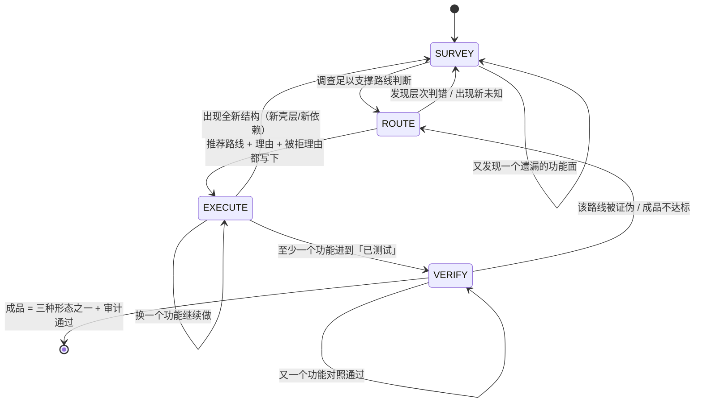

# 攻坚交付闭环 · 权威定稿（2026-10-13）

> **性质**：本项目主定稿。只管一件事——
> **把「拿到任意一个受保护目标 → 最终交付可用成品」这条路彻底打通并验证。**
>
> **配套目标清单**：`docs/GOAL-PROMPT-ASSAULT-2026-10-13.md`（整段复制进 `/goal set`）。
>
> 本文所有事实性陈述来自 2026-10-13 对 `C:\relab2` 的实查。标 `[推断]` 的是推断，未实跑写「未实测」。

---

## 0. 先讲清楚本文的组织原则：这是状态机，不是步骤表

**本方案刻意不规定「第几步」。** 规定步骤数等于限制能力——真实目标千变万化，
有人三个状态转一圈就完，有人要转三十次，取决于目标而不是取决于表。

本文的组织是：

```
一份滚动报告（assault.md）  —— 唯一的工作载体，越改越准
    ↑ 被下面这个状态机驱动
四状态机（SURVEY / ROUTE / EXECUTE / VERIFY）—— 之间可任意跳转，无顺序、无次数限制
    ↑ 被三条铁律约束
三条铁律（不可变）
```

- **报告是滚动的，不是一次性交付物。** 每次状态跳转都回写报告；
  报告的任何一格都可以被后面的新证据推翻重写。
- **状态机没有「下一步一定是 X」。** 从任何状态都可以因为一个发现跳到任何其他状态。
- **唯一不可变的是三条铁律和终点定义。**

这套结构直接来自用户原话（写进规则，防止后面有人把它改成步骤表）：

> 「他自己给我一份非常详细的报告，什么清单类型的……然后他自己说哪种路线概率最大……
> 但是不一定他说那个概率大就真的概率大，他要在后续真实的操作过程中，
> 像人一样不停地调整……因为它刚开始分析不一定完善，后面一边操作一边补充，
> 也许就让它的思路越来越清晰。」

---

## 1. 终点定义（整个项目唯一的目的地，不许偏移）

> **任何一个程序 / APK / 固件 / 网站客户端，无论它套了多少层保护——加壳、虚拟化、混淆、
> 反调试、反虚拟机、云端验证、授权卡密、签名校验、自检、设备绑定，或以上全部的组合——
> AI 都能尽最大努力走到一个终点：交付一个可运行、可验证、功能与原目标等价的成品。**

成品只有三种形态，不许发明第四种：
1. 源码 / 可构建项目
2. 可运行的复刻实现
3. 打了补丁的原程序

---

## 2. 三条铁律（不可变，其余全部可调）

**铁律一：报告必须随时能回答「现在到哪了、凭什么这么走」。**
任何时刻打开 `assault.md`，必须能看到：当前处于哪个状态、这一层的结论是什么、
下一步是什么、以及**凭什么**（引用哪条 Evidence）。答不上来 = 漂移，停下来重写报告。

**铁律二：新证据推翻判断时，允许且必须跳回任何状态。**
不许为了维护原计划忽略新证据。路线被证伪了就换路线，层次判错了就重判，
「已经投入很多时间」不是继续一条错路的理由。（这与 `re-agent-workflow.md` §7.3
「允许调整路线」同向，此处升级为铁律。）

**铁律三：终点只有三种成品，验证只有一种方式。**
「分析报告很完整」不是成品。「程序能启动」不是成品。
成品 = 三种形态之一，且通过同输入对照 + `review_case.py` 审计。

---

## 3. 现状诊断（先认病，否则建出来的还是同样的东西）

### 3.1 病症一：知识库很深，但默认路径是 CTF 五件套（最致命）

实查确认我们的 VMP 覆盖非常完整：

| 文件 | 内容 |
|---|---|
| `references/vmp-virtualization-analysis.md` | VM entry 定位四步法、dispatcher 三段式、VM key 追踪、2.x/3.x 差异、四条外部可观测判据 |
| `references/vmp-devirtualization-toolchain.md` | 三级降级（NoVmp/angr DSE/trace 折叠）、本机工具现状、等价性验证脚本与判据 |
| `references/signal-to-tool-decision.md` §7 | VMP 信号决策 |
| `tools-advanced.md` VMProtect/Themida 节 | 识别与工具 |

**但用户拿到 VMP 样本，实际走的是这条路**：命中 R0 → `reverse-engineering/SKILL.md`
的 `Problem-Solving Workflow` 八步——`strings 提 flag` / `ltrace` / `Frida hook strcmp` /
`angr` / `Qiling`；`Quick Wins` 第一条是 `floss binary | grep -iE "flag|secret|password|key"`。

**这五件在 VMP 面前全军覆没**（没有明文、没有 strcmp、angr 路径爆炸）。
而那两篇好文档挂在 `Additional Resources` 第 83 行，要 AI 自己想到才会打开。
更糟的是 `signal-to-tool-decision.md` §7 只写「参考 ../../patterns*.md」——**指了个空**。

**结论：不是知识不够，是入口错了。有一座军械库，门口指示牌写着「先用弹弓」。**

### 3.2 病症二：攻坚没有对账表，半成品不可累积

`rebuild.md` 只挂在「复刻交付」路径上（`case-init -Preset rebuild` 才生成）。
攻坚这条路打到最后，AI 手里没有一张「目标有哪些功能 / 哪些已还原 / 哪些卡住 / 差什么」的表，
只有一份越来越长的分析笔记。下次接手从零开始。

### 3.3 病症三：38 条门禁全自指，无一条测「能不能打下真实目标」

实查全部 25 条 `ci-gates.json` + ci.yml 裸 run + kernel 151 断言：
测路由一致性、文档闭合、门禁自身没退化。**没有一条在真实硬目标上跑过端到端。**
`KNOWN-BOUNDARIES.md` 第 4 条自己承认：「任何真实目标上的效果——做不到的原因：这是技能包，不是测试环境。」

这不是说前两个月白做——对账表、差异对照、经验卡、探测层、VMP/KMS 知识全是真资产。
但它们现在**全是质量资产，不是战力资产**。

### 3.4 病症四：方法论被套到不适用的任务上

本项目反复出现的失败模式：把逆向工序套到日常开发上。
kernel 的 `04-全能工程中枢` 早已建成六条线（`desktop-product` / `web-service` /
`cli-tool` / `source-takeover` / `exe-rebuild` / `protocol-automation`），
**本次新增的是第七条线 `assault`**，它不覆盖前六线，前六线也不覆盖它。

---

## 4. 滚动报告 `assault.md`（唯一工作载体）

**位置**：`skillpack/skills/templates/assault.md`，由 `case-init -Preset assault` 生成
（与 rebuild 预设同档授权；**不传该预设时日常路径逐字节不变**）。

**设计原则：报告是字段清单，不是填写顺序。** 下面的每一格都是「报告必须能回答的问题」，
**不规定什么时候填、填几次、按什么顺序填**。有些格 SURVEY 时就有了，有些 EXECUTE 一半
才出现，有些会被推翻重写——都合法。

```
## 0 状态行（铁律一的落脚点，任何时刻打开报告先看这里）
- current_state:      SURVEY | ROUTE | EXECUTE | VERIFY
- since:              进入该状态的时间
- goal_now:           这个状态里要解决的问题（一句话）
- why_this_state:     凭什么在这个状态（引用 Evidence / 上一状态的结论）
- next_milestone:     这个状态的出口条件（可判定的事实，不是形容词）
- open_unknowns:      未决问题条数（对应 §unknowns）

## target
- deliverable:        最终成品（源码项目 / 复刻实现 / patch 后的原程序 / 可用绕过态）
- form:               源码 / exe / apk / patch / script
- upstream:           目标文件 路径 + 版本 + SHA256
- analysis_tool:      本次分析用的工具与版本（例: idat64_83 / Ghidra 11 / diec 6 / pe-sieve）
- user_intent:        用户原话（不许改写成技术方案）

## survey（SURVEY 状态的产出；可被后续推翻重写）
- 目标画像:           格式 / 架构 / 技术栈 / 运行条件
- 保护层台账:          见 ## layers
- 外部依赖:           远程服务 / 账号 / 授权服务 / 设备 / 系统组件，逐项记
                      「本地实现 / 远程依赖 / 混合」三分类
- 功能地图:           每项功能的入口、输入、预期输出、异常表现、当前理解程度
- 主动遗漏检查:       是否只看了主界面？是否漏了配置/缓存/本地库/网络/重启后状态？
                      （这一格是「主动发现遗漏」的落点，不是走过场）

## layers（分层台账；VMP+云端+自检混合目标的关键）
| 层 | 类型 | 状态 | 证据 |
| L0 | 容器层（安装包/ASAR/固件/双体） | | |
| L1 | 壳层（加壳/压缩/加密/虚拟化） | | |
| L2 | 混淆层（OLLVM/虚假控制流/MBA/串加密） | | |
| L3 | 自检层（反调试/反VM/反注入/完整性） | | |
| L4 | 业务层（授权/算法/协议/格式/网络） | | |

分层判定的固定顺序（这是**判据**不是步骤：任何时刻都要能说清目标在哪几层）：
L0 容器 → L1 壳 → L2 混淆 → L3 自检 → L4 业务

**「搬运工还是货物」铁律**（源自 `license-keygen/README.md` 与 `re-agent-workflow.md` §2.1）：
> 在 L1 里做的每一处修改，都要问一句「我改的是搬运工还是货物」。
> 判定点几乎从不在 L1。停在壳层打转 = 项目没推进。

每层的过层判据（外部可观测，不用形容词）：
| 层 | 过层判据 |
|---|---|
| L0 | 拿到目标架构真实可执行体（`file` 符合预期、能加载进 r2/Ghidra） |
| L1 | IAT 从个位数涨到几十上百条；`.text` 熵从 >7.2 降到 <6.5；`iS` 无 rwx 节 |
| L2 | 反编译出可读控制流（不再是星形跳转）；布尔表达式可化简 |
| L3 | ScyllaHide 实测 peb/crdp/dbgport 三项归零；程序正常运行超 10s |
| L4 | 关键函数反编译可读；算法/协议/格式能说出输入输出契约 |

## routes（ROUTE 状态的产出；可被推翻重写）
| 候选路线 | 证据 | 预计成本 | 主要风险 | 为什么选/不选 |
| patch / recover / rewrite / keep / blocked 各自一行 |
- recommended:     当前推荐哪条 + 理由
- rejected_because: 其他路线为什么不优先（每行一句,不许空）
- confidence:      high | medium | low —— low 时必须写「还需要什么证据才能定」

★ **推荐路线不是承诺。** EXECUTE 过程中任何一条被证伪 → 回到 ROUTE 重写本表，
并在 timeline 记 `decision_delta: [route <旧> -> <新>, reason <...>]`。

## functions（功能/待还原单元；EXECUTE 的主账）
| ID | 名称 | 所属层 | 路线 | 状态 | 证据 | 备注 |
| F-001 | | | | | | |

状态阶梯**复用 rebuild.md 的四态**（已分析 → 已实现 → 已测试 → 对照一致），不造新标准。
特殊态 `受限`：该行暂时不可达，备注写清原因/影响/替代方案。
**状态列只能升到证据列支撑的高度**——证据不足不是「不能标」，是「先补证据再标」。

## findings（关键结论：算法/密钥/协议/格式/漏洞）
| ID | 结论 | 类型 | 证据 |
| A-001 | | reverse_algo / proto / format / key / vuln | E-xxx |

## unknowns（未决问题清单；这是「越走越清晰」的直接体现）
| ID | 问题 | 影响功能 | 已尝试 | 下一步 | 是否阻塞 |
| U-001 | | | | | yes/no |

★ 本表**只增不减或改状态，不删除**。解决了的标「已解 + 解在哪」，
新出现的追加。它回答「我现在到底还差什么」。

## diff_baseline（同输入对照；成品验收的唯一依据）
- baseline_command:  <驱动原程序的命令；{input} 占位>
- rebuilt_command:   <驱动新实现的命令；{input} 占位>
- cases:             <输入清单>
| F-ID | 输入条件 | 原程序结果 | 新实现结果 | 是否一致 | 说明 |

驱动与记录复用 `skills/scripts/diff-runner.py`，草稿落 `diff/<F-ID>.md`。
两个命令必须在同一 shell 语义下跑，模式/编码这类环境差异要在命令里固定住
（例：`sha256sum -t` 固定文本模式）。

## out_of_delivery（明确不做的与理由）
| 项 | 理由 |
|---|---|
```

---

## 5. 四状态机（无顺序、无次数限制、可任意跳转）



**每个状态只定义三件事**：这个状态里什么算有效动作 / 出口条件 / 什么情况下必须跳走。

### SURVEY（勘察）

**有效动作**：摸清目标是什么、有哪几层、依赖什么、有哪些功能、哪些还不知道。

**报告必须能回答的问题**（这是**字段清单，不是顺序**；回答顺序不限，但缺一就是没勘察完）：

| # | 问题 | 本机可用手段 |
|---|---|---|
| 1 | 它是什么格式/架构/版本？ | `diec -d -e -j`、`file`、SHA256 |
| 2 | 结构与节区？ | r2 `iI/iS/ii/iz`、`pefile`/`lief`、权限与熵 |
| 3 | 有什么字符串与常量？ | `floss`（静态+栈+解码三路）、`strings -el` 宽字符 |
| 4 | 有什么能力特征？ | `capa -r <rules> -j` |
| 5 | 有没有反调试/反VM 面？ | `pe-sieve`、`procmon`、`anti-debug-bypass.md` 速查 |
| 6 | 跑得起来吗？ | 直接跑（本机纪律允许）；不能跑的记「未实测」 |
| 7 | 依赖什么外部东西？ | 导入表高危簇、硬编码域名/IP、本地服务/端口 |
| 8 | 有哪些功能？ | 界面入口 / 命令行 / API / 文件格式，逐项列 |
| 9 | 我漏了什么？ | **主动遗漏检查**（见报告 survey 段） |

**出口条件**：上面九项都有答案，「未知清单」里的每一项都写明了「影响什么、已试过什么、
下一步、是否阻塞」。

**必须跳走的情况**：任一高层判定反复被推翻（判错层次）→ 留在 SURVEY 重判，别硬往下走。

### ROUTE（路线判断）

**有效动作**：比较候选路线，给出推荐**和理由**，同时写下其他路线为什么不优先。

**候选路线（五种，均已有工序支撑）**：

| 路线 | 什么时候考虑 | 工序 |
|---|---|---|
| `patch` | 原程序主体可用，问题范围明确 | `code-patching.md` + `aob-signature-scan.md` |
| `recover` | 能恢复足够逻辑，源码级项目有价值 | 反编译产物整理 + `reclass-reconstruction.md` |
| `rewrite` | 恢复不出原始实现，但输入输出关系可推导 | `struct-reconstruction.md` / 行为对照 |
| `keep` | 某模块原样能用，只做接口适配 | `unpack-and-memory-dump.md` |
| `blocked` | 暂时不可达（外部服务拿不到等） | 写清原因/影响/替代，其余行照常 |

**L4 业务层的分流**（这部分是判据，照 `license-keygen/README.md` 的分类）：
本地算法 → `license-keygen-03`；签名链 → `license-keygen-04`；
自引用 → `license-keygen-07`；云端 → `license-keygen-06`；
网络协议 → `protocol-reverse` 或 `web-protocol-reverse`；
文件格式 → `struct-reconstruction.md` / `reclass-reconstruction.md`；
PRNG → `prng-caching.md`；加密 → `crypto-algorithm-identification.md`。

**出口条件**：`routes` 表每行都有「证据 / 为什么不选」，`recommended` 有理由，
`confidence` 已标。

**必须跳走的情况**：confidence=low → 不许进 EXECUTE，回 SURVEY 补证据，
或者先做一个小范围验证（「高风险假设优先验证」原则）。

**反模式（一句话）**：只跑 strings 看到疑似序列号字符串就直接进 `license-keygen-03`。
跳过分类的代价是 **90% 时间浪费在一个不存在的本地公式上**（`license-keygen/README.md` 原话）。

### EXECUTE（执行）

**有效动作**：按推荐路线推进，逐功能还原/打补丁/复刻，每完成一格就回填报告。

**规矩（全部来自既有铁律，不是新发明）**：
- 每改一层必须验一层，产出可运行候选，严禁单测造假
- 等长替换 / 只改分支不覆盖函数入口 / 不 NOP 间接调用（`re-agent-workflow.md` §2.2 三条铁律）
- 每层补丁不超过 2 轮无通过判据就收敛刹车（`re-agent-workflow.md` §2.3.5）
- 时间盒：静态深挖约 15 分钟无关键路径 → 转动态；单步约 200 条指令无进展 → 回静态
- **产物先落盘并校验哈希，之后才允许清理**（既有输出纪律）

**出口条件**：至少一个功能进到「已测试」，且 `diff/` 有对照运行记录。

**必须跳走的情况**：
- 该功能在该路线上连败两次 → 回 ROUTE 换路线（不许在原路线加第三个补丁）
- 出现全新结构（发现新壳层/新依赖）→ 回 SURVEY 补 layers

### VERIFY（验证）

**有效动作**：同输入驱动原程序与新实现，逐项比；不达标的回 ROUTE。

**验收判据（外部可观测）**：
- `diff_baseline` 表逐行有「原程序结果 / 新实现结果 / 是否一致」
- 非确定项（时间/随机）先标 `NONDETERMINISTIC`，由人定容差，不许为通过而放宽标准
- `review_case.py --verify-hashes --strict` PASS

**出口条件（= 项目完成）**：`deliverable` 指向的产物**真实存在于磁盘**、可运行或可构建，
且全部功能行处于「对照一致」或「受限 + 具体原因」。

**必须跳走的情况**：任何一行对照不通过 → 回 ROUTE 或 EXECUTE，**不许把不通过改成通过**。

---

## 6. 从 REA 学什么（三条，已克制到最小；不 vendor、不进路由）

REA（morluto/rea）是 npm 包 + MCP server。实测首发 2026-07-12、**10 月前 10 天发 9 个版本**，
vendor 两周即过期、pin 即锁死。**只学三条设计，不融代码**：

| 学什么 | 怎么落地 |
|---|---|
| ①「目标类型 → 第一个工具」的独立路由层 | 就是本文 §5 的 layers + routes 两张表 |
| ②「能力声明与安装物解耦」 | 进 `RULES.md` Output Quality 段一条：文档描述的能力 ≠ 本机装有的，以探测层实测为准 |
| ③「工具版本 + 样本哈希」双钉 | `assault.md` 的 `analysis_tool` + `upstream` 两字段 |

**不学**：把 12 类目标塞进一个 237 行 SKILL.md；没有授权门。

它最强的 DX-Ball 案例给了我们一条新判据，值得记入但**本次不作为强制**（避免又变成步骤）：
**字节级 replay**——用原作者那年代的编译器重编，与原文件逐字节匹配。
这是「我真理解了他怎么写」的机器判据，比行为等价更硬。
本项目在 VERIFY 状态遇到「行为一致但想更强证明」时可选使用。

---

## 7. 红线（七条）

1. **不推送远端仓库**，只本地 commit。开工前 commit（`攻坚交付闭环 · 开工基线 2026-10-13`），
   完成后 commit（`攻坚交付闭环 · 完成`）。
2. **不碰 `kernel/`**。kernel 的破甲卡与六条工作流只读；本次只在新文件里**指路**，不重写。
3. **日常路径零变化**：不传 `-Preset assault` 时，case-init / review_case / 门禁行为与开工前一致。
4. **CTF 五件套降级不删除**：`reverse-engineering/SKILL.md` 的 8 步工作流必须仍在，
   只改标注、插入口。出现删除行即回退重做。
5. **不新增顶层技能、不改 `routing.json`**：新增全在 `references/` 与 `templates/` 层。
6. **不许为了让门禁绿而降判据**：`re-agent-workflow.md` §13.5。
   查明目标真的打不下来，如实写 blocked + 原因，那是**有效交付**；假装打过才是失败。
7. **不许把攻坚工序套到非逆向任务上**：正常开发 / 维护 / 修 bug / 部署 / 文档，
   走既有路由与技能，零额外工序（见 `assault-entry.md` 的 Q0）。

---

## 8. 判据口径（全程有效）

- 未实跑不许写「已实测」。本机跑不了的必须写「本机未实测」
  （已知：`test-bash-workflow.sh`、bash 侧默认目录治理——本机 `python3` 是 WindowsApps 占位符）。
- 判据必须是外部可观测事实：文件真被创建、字节真被改、命令真回显预期输出。
  不许用「日志里出现我自己写的标记」（经验卡 `gate-self-must-prove-failure`）。
- 每一层过层判据用 §4 的表，不用形容词。
- 同一方法连败两次 → 换方法，不许在原路线上加第三个补丁。
- **成品的定义是「可运行 + 可对照 + 可审计」，不是「分析报告很完整」。**
- **报告的任何一格都可以被推翻重写**（铁律二）——但推翻必须写 decision_delta，不许静默改。

---

## 9. 完成记录（追加，勿改历史）

```
### <状态流转记录> · <YYYY-MM-DD HH:mm>
- 做了什么:
- 改了哪些文件:
- 验收命令与结果:
- 门禁结果:
- commit:
- 未达标/遗留:
```

（以下为记录区）

### 阶段 1 · 入口卡 + 主流程改道 · 2026-10-13 02:50
- 做了什么: ①新建 `references/assault-entry.md`（分流器，非步骤表）：Q0 任务归类
  （A 日常开发→止步 / B 逆向→Q1-Q3 / C 有源码→code-audit）、Q1 目标类型表（8 类形态→首查手段）、
  Q2 保护层次（L0–L4 分层 + 五层过层判据表 + 混合组合三例 + 「搬运工还是货物」铁律）、
  Q3 成品三形态、Q4 L4 业务分流（8 条工序卡映射）。②`SKILL.md`：ACTION REQUIRED 在
  「查经验卡」之后插入第 4 步「读 assault-entry 完成四问」（利用既有编号缺口 3→5，
  **零重编号**）；`Problem-Solving Workflow` 标题行**原样保留**、其下新插入定位标注
  （triage 内部动作，不再作为主路径）；Additional Resources 加 assault-entry 首行指针。
  ③`signal-to-tool-decision.md` §7 修「指空」：`../../patterns*.md` →
  `vmp-virtualization-analysis.md` + `vmp-devirtualization-toolchain.md`。
- 改了哪些文件: 新增 `skillpack/skills/reverse-engineering/references/assault-entry.md`（7370B）；
  改 `SKILL.md`（+9 行，**0 删除**——首版误删标题行，按红线 4 回退重写为零删除方案）；
  改 `signal-to-tool-decision.md`（1 行替换，指向修复）
- 验收命令与结果（全部实跑）:
  - **四例走查**（入口卡内容与实查目标文件核对）:
    1. VMP（diec 报 VMProtect + dispatch loop）→ Q1 表「自定义 VM」行落
       `vmp-virtualization-analysis.md`（L1 壳层），全程不经 strings/floss/angr
    2. Themida（致闪退）→ Q2 混合组合「Themida + 自检」行：先过 L3
       （`anti-debug-bypass.md` + ScyllaHide 专项段）再 dump
    3. 云端授权 → Q4 表「云端校验（断网即失败）」→ `license-keygen-06`；
       Q4 下方「分类先行」引 license-keygen README 断网实验判定树
    4. 加固 APK（apktool 解不开）→ Q2 组合「加固 APK」→ `apk-reverse/references/packer/` 链
    （四例的目标文件 `vmp-virtualization-analysis.md` / `anti-debug-bypass.md` /
    `license-keygen-06` / `apk-reverse/references/packer/` 均已实查存在）
  - **Q0 分流验证**: Q0 表 A 类判据 = 「代码是我方写的，或任务是：写新功能/修 bug/重构/
    部署/写文档/写脚本/加参数/做工具」→ 「给 Python 脚本加 --verbose 参数」命中 A → 
    「本卡一行不必再读」；Q0=A 分支明写「不建 assault.md、不填 layers、不进任何工序」
  - `git diff SKILL.md` deletions = **0**（grep `^-[^-]` 空）；8 步工作流 grep 计数 = **8**（全在）
  - `check-fences.py` rc=0；`verify-doc-links.py` rc=0（active=0）
  - `audit-doc-code.py` → **rc=0**（2570 可审计块、真错 0；仅 1 处「截断片段（不算错）」提示：
    `api-security/references/payment/payment-race-lost-update.md:214`，与开工基线相同，
    非本次改动引入）
  - `test-routing.ps1 -Quick` → **65/65 ALL PASS**；`test-routing.sh` → **205/205 ALL PASS**
    （python3 shim 指向真实 Python 实跑）
- 门禁结果: 上列（audit-doc-code 结果见下条补记）
- commit: （本段提交）攻坚交付闭环 · 阶段1 入口卡与改道
- 未达标/遗留: 无
