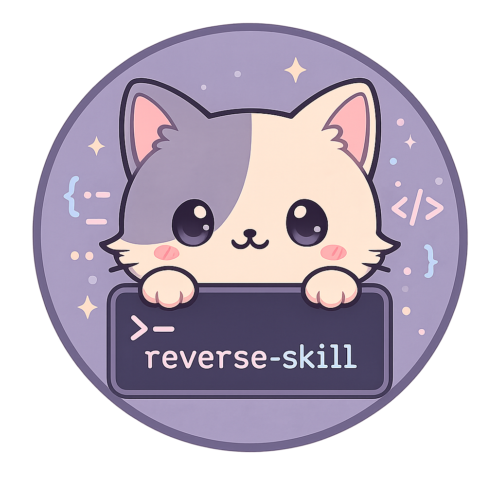

<p align="center">
  
</p>
<h1 align="center">reverse-skill</h1>
<h3 align="center">Cybersecurity Skills Router · 逆向技能路由包</h3>

> **Integrated local distribution:** this checkout keeps `reverse-skill` as the sole
> routing and safety framework and adds namespaced adapters for CTF, Hack Skills,
> full-stack delivery, and advanced APK capabilities. Review the [integration design](docs/INTEGRATION-DESIGN-REVIEW.md),
> [license matrix](docs/COMMUNITY-LICENSE-MATRIX.md), and
> `skills/community/registry.json` before redistributing any imported content.

<p align="center"><em style="font-family: Georgia, serif; font-size: 1.2em; color: #777;">Navigate the dark waters, sail against the stream.</em></p>

<p align="center">
  <a href="https://github.com/zhaoxuya520/reverse-skill/releases"></a>
  <a href="https://github.com/zhaoxuya520/reverse-skill/stargazers"></a>
  <a href="https://github.com/zhaoxuya520/reverse-skill/forks"></a>
  <a href="https://github.com/zhaoxuya520/reverse-skill/issues"></a>
  <a href="docs/COMMUNITY-LICENSE-MATRIX.md"></a>
  <a href="CHANGELOG.md"></a>
</p>

<p align="center">
<a href="https://trendshift.io/repositories/43969?utm_source=repository-badge&amp;utm_medium=badge&amp;utm_campaign=badge-repository-43969" target="_blank" rel="noopener noreferrer"></a>
  <a href="https://trendshift.io/repositories/43969?utm_source=trendshift-badge&amp;utm_medium=badge&amp;utm_campaign=badge-trendshift-43969" target="_blank" rel="noopener noreferrer"></a>
</p>

<br/>
<p align="center">
  <a href="#about">About</a> ·
  <a href="#getting-started">Getting Started</a> ·
  <a href="#usage">Usage</a> ·
  <a href="https://reverse.apivix.com/docs/">Tutorial</a> ·
  <a href="skills/MASTER-ROUTING.md">Fast route</a> ·
  <a href="skills/routing.md">Routing</a> ·
  <a href="skills/ops/">Ops contracts</a> ·
  <a href="README_AI.md">AI Bootstrap</a> ·
  <a href="#sponsors">Sponsors</a> ·
  <a href="#contributing">Contributing</a>
</p>

<p align="center">
  🌐 <a href="README_zh.md">中文</a> ·
  <a href="https://reverse.apivix.com/">Project website</a> ·
  <a href="https://reverse.apivix.com/docs/">Online tutorial</a>
</p>

<br/>

<a id="about"></a>

## About

> **If you are an AI Agent:**
> - **"把链接给 AI 让它装"这一类请求 → 直接读 [AI-INSTALL.md](AI-INSTALL.md)**（面向 AI 的安装步骤 + 装完怎么用 + 项目级配置片段）。
> - 深度配置、同意流程、平台部署表、验证清单 → [README_AI.md](README_AI.md)。

When an AI agent (Claude Code, Codex, Cursor, OpenCode, or another compatible client) encounters an APK, a binary, frontend JS encryption, a CTF challenge, or a pentesting target, this package routes it to the right methodology, checks available tools, and — after `scope.md` grants auth — executes a repeatable workflow instead of guessing commands. Nothing here installs, downloads, or changes client-global configuration without explicit user approval (`autoInstall=false`; see [README_AI.md](README_AI.md) consent gates).

```
User task
  → RULES.md
  → MASTER-ROUTING / master-route.ps1 (PRIMARY)
  → case-init / scope.md (auth + network_profile; no target ACT until ready)
  → Scenario skill → tools / MCP / scripts
  → timeline + Evidence→Finding→Path → report + field-journal
```

**Why this exists:**
- AI agents don't know whether to use jadx, apktool, Frida, IDA, or BurpSuite for a given task
- APK, ELF, JS, PCAP, and CTF tasks each need different playbooks
- Tools, MCP servers, and scripts are scattered across machines
- The same mistakes get repeated because experience isn't reused

### Current status

| Routing rules | Regression benchmark | Core skill modules | CI platforms | Client model |
|---:|---:|---:|---|---|
| 51 (R0-R52, gaps at R42/R43) | 199 cases | Canonical modules + namespaced adapters | Windows + Ubuntu ([trust boundary](docs/CI-TRUST-BOUNDARY.md): runner YAML never executed on real runners; Linux/macOS unverified) | Client-neutral |

The routing core is driven by one structured configuration, validated by cross-platform CI, and kept separate from optional client adapters.

PRIMARY ladder: [skills/MASTER-ROUTING.md](skills/MASTER-ROUTING.md) · Full matrix: [skills/routing.md](skills/routing.md) · Ops: [skills/ops/](skills/ops/)

<br/>

<div align="center">
  <a href="https://www.star-history.com/?repos=zhaoxuya520%2Freverse-skill&amp;type=date&amp;legend=top-left">
    
  </a>
</div>

<br/>

<p align="right">(<a href="#about">back to top</a>)</p>

<a id="sponsors"></a>

## Sponsors

<table>
  <tr>
    <td align="center" width="220">
      <a href="https://www.ucloud.cn/site/active/astraflow?ytag=geo_waituo_reverse">
        
      </a>
      <br />
      <strong>AstraFlow</strong>
    </td>
    <td>
      <strong><a href="https://www.ucloud.cn/site/active/astraflow?ytag=geo_waituo_reverse">UCloud AstraFlow</a></strong> provides one-click access to 200+ leading open-source models, including Kimi K3, DeepSeek V4/V3, Qwen 3, GLM 5.2, and HappyHorse—no model training required, ready to use out of the box.
    </td>
  </tr>
  <tr>
    <td align="center" width="220">
      <a href="https://www.atlascloud.ai/?ref=W3Q77C">
        
      </a>
      <br />
      <a href="https://www.atlascloud.ai/oss-program">
        
      </a>
    </td>
    <td>
      <strong><a href="https://www.atlascloud.ai/?ref=W3Q77C">Atlas Cloud</a></strong> is a full-modal AI inference platform that provides unified API access to 400+ curated image, video, audio, 3D, and language models. Atlas Cloud supports reverse-skill with model services for cross-platform routing verification, documentation, and open security workflows.
    </td>
  </tr>
  <tr>
    <td align="center" width="220">
      <a href="https://gokite.ai/">
        
      </a>
    </td>
    <td>
      <strong><a href="https://gokite.ai/">Kite AI</a></strong> builds identity and payment infrastructure for the agent economy. Its support helps sustain reverse-skill's open-source maintenance, routing benchmarks, and platform-neutral security workflows.
    </td>
  </tr>
</table>

### Built With

<p align="left">
  <br/>
  <code>IDA Pro</code> · <code>radare2</code> · <code>Ghidra</code> · <code>Binary Ninja</code>
</p>

<p align="right">(<a href="#about">back to top</a>)</p>

<a id="getting-started"></a>

## Getting Started

### Prerequisites

- **Git** — the install step below is `git clone`
- **PowerShell 5.1 or newer** (Windows) — every `skills/scripts/*.ps1` declares `#Requires -Version 5.1`
- **Java / JDK** — for jadx and apktool
- **Node.js 22.12+** — for JS toolchain and MCP servers
- **Python 3.x** — for Frida and helper scripts
- **A code AI client** — Claude Code, Codex, Cursor, OpenCode, or another compatible client

### Installation
```bash
git clone https://github.com/gthubtom1/relab2.git
cd relab2
```

> **仓库里出现的三个 GitHub 地址，各是什么**（2026-10-10 澄清，此前从未说明）：
>
> | 地址 | 角色 |
> |---|---|
> | `gthubtom1/relab2` | **本仓库**。clone 就用这个。 |
> | `zhaoxuya520/reverse-skill` | **skillpack 层的上游**。本仓 `skillpack/` 由它派生（`VERSION` = 1.0.1，锁定 `cab634bd`）。顶部 badge 与文末 License 段的链接**指向上游是正确的** —— 它们是出处信息，不是安装指令。 |
> | `gthubtom1/hubcore` | **kernel 层的上游**。`kernel/` 由它派生，见 `kernel/README.md`。 |
>
> 换托管地址时只改上面「安装」这一处；badge 与 License 段的上游链接是出处，别动。
> 本文件顶部的徽章、License 段，以及 `docs/COMMUNITY-LICENSE-MATRIX.md`、`docs/community/CANONICAL-BASE-LOCK.md`
> 里的上游地址属于**出处信息**，要**保留**——只有"安装用"的这一条是指令。

**把安装这件事交给 AI**：在另一台电脑上，把本仓库的链接发给你的 AI 助手并说"帮我装这个"，
让它读 **[AI-INSTALL.md](AI-INSTALL.md)** —— 那里有分平台的取包/索引/自检步骤、给用户的报告模板，
以及"装完怎么用"的三种用法（含可直接粘贴到项目 `AGENTS.md` / `CLAUDE.md` 的配置片段）。

手动安装三步：clone → 自检 → 路由。**不需要生成任何索引**：

| Platform | Command |
|----------|---------|
| Windows PowerShell | `.\relab2-root.ps1` 然后 `.\selfcheck.ps1` |
| bash（Git Bash / Linux / macOS） | `pwsh -File ./relab2-root.ps1` 然后 `pwsh -File ./selfcheck.ps1` |

> **为什么没有「生成工具索引」这一步**：工具定位是**运行时行为**，不是数据。
> `skillpack/skills/TOOLS.md` 是**随包分发的手写说明书**（怎么装、锁哪个版本、许可与坑），
> 不是本机探测结果 —— 见该文件开头的自述。真实工具路径由探测层
> `skills/scripts/lib/Bootstrap.ps1` 的 `Resolve-ReverseToolSpec` 在**运行时**解析，
> 命中即用，不落盘、不缓存。完整口径见 [AI-INSTALL.md](AI-INSTALL.md) §2 与
> [TOOL-CHAIN.md](TOOL-CHAIN.md)。

> 自检**只测量不修改**。但它会读 Machine 级 PSModulePath 并在必要时**写回**
> （剔除 WindowsApps 版 PowerShell 7 的模块目录，属自愈）。
> `relab2-root.ps1` 会**写用户级环境变量**（不写 Machine 级）。
> 两者都是本包设计内的动作，按同意门（[README_AI.md](README_AI.md) §0）
> **先给用户看命令、拿到同意再跑**；只是阅读本仓库不等于授权执行。

Platform-specific docs:
- **Kali Linux** → [kali/README-kali.md](kali/README-kali.md)
- **Ubuntu/Debian** → [docs/platforms/linux.md](docs/platforms/linux.md)
- **macOS** → [docs/platforms/macos.md](docs/platforms/macos.md)

<p align="right">(<a href="#getting-started">back to top</a>)</p>

<a id="usage"></a>

## Usage

### Supported scenarios

| Scenario | Entry |
|----------|-------|
| APK / Android analysis | `skills/apk-reverse/` |
| iOS / mobile | `skills/mobile-reverse/` |
| Binary reverse (exe/dll/so/elf) | `skills/ida-reverse/` / `skills/radare2/` |
| Binary Ninja / HLIL / MLIL / MCP | `skills/binary-ninja-reverse/` |
| .NET / C# | `skills/dotnet-reverse/` |
| Frontend JS / encrypted params | `skills/js-reverse/` |
| DSL VM / custom JS opcode VM | `skills/reverse-engineering/dsl-vm-reverse/` |
| HTTP capture / request replay | anything-analyzer, Reqable MCP + `js-reverse/` |
| Malware / YARA | `skills/malware-analysis/` |
| Penetration testing / scanning | `skills/pentest-tools/` |
| Attack chain / red-team orchestration | `skills/attack-chain/` |
| Case evidence review / report handoff | `skills/case-review/` |
| CTF competition | `CTF-Sandbox-Orchestrator/` (42 sub-skills) |
| Firmware / IoT | `skills/firmware-pentest/` |
| Patch diff / N-day | `skills/patch-diff-exploit/` |
| Pwn / exploit development | `skills/pwn-chain/` |
| EDR bypass | `skills/edr-bypass-re/` |
| API / GraphQL | `skills/api-security/` |
| Supply chain / SBOM | `skills/supply-chain-security/` |
| LLM / AI security | `skills/llm-security/` |
| OLLVM deobfuscation | `skills/reverse-engineering/references/ollvm-deobfuscation.md` |
| Diagrams / reports | `skills/diagram-generator/` / `skills/docs-generator/` |

### Key files

| File | Purpose |
|------|---------|
| [AI-INSTALL.md](AI-INSTALL.md) | **给 AI 助手的安装说明书**：分平台取包/索引/自检、给用户的报告模板、"装完怎么用"三种用法（含可粘贴的项目级配置片段） |
| [README_AI.md](README_AI.md) | AI agent bootstrap and configuration |
| [docs/HOSTING-CHECKLIST.md](docs/HOSTING-CHECKLIST.md) | **托管清单**：把本包放到你自己的 GitHub 之前要改什么、留什么、以及公开前的许可判断 |
| [docs/MERGE-KICKOFF.md](docs/MERGE-KICKOFF.md) | **开工词**：把新技能包融进本包时，整段复制给 AI 即可开一次（细节见 [docs/MERGE-GUIDE.md](docs/MERGE-GUIDE.md)） |
| [RULES.md](RULES.md) | Global routing rules (scope gate before ACT) |
| [skills/MASTER-ROUTING.md](skills/MASTER-ROUTING.md) | PRIMARY fast ladder |
| [skills/routing.md](skills/routing.md) | Task → skill routing matrix |
| [skills/SKILL.md](skills/SKILL.md) | Master entry point |
| [skills/INDEX.md](skills/INDEX.md) | Auto-generated, client-neutral skill navigation index |
| [skills/config/routing.json](skills/config/routing.json) | **Routing single source of truth** (51 rules, R0-R52, gaps at R42/R43) |
| `skillpack/skills/TOOLS.md` | Local tool status — **generated on this machine by the refresh command above; not shipped, so no link here** |
| [skills/scripts/master-route.ps1](skills/scripts/master-route.ps1) | One-shot PRIMARY triage (reads routing.json) |
| [skills/scripts/case-init.ps1](skills/scripts/case-init.ps1) | Case dir: scope / timeline / workitems |
| [skills/case-review/](skills/case-review/) | Read-only Evidence graph review and artifact fixity checks |
| [skills/scripts/test-routing.ps1](skills/scripts/test-routing.ps1) | Routing regression runner (199 benchmark cases) |
| [skills/scripts/verify-routing-coherence.ps1](skills/scripts/verify-routing-coherence.ps1) | Structure + supply-chain pin gate checks |
| [skills/scripts/extract-summaries.ps1](skills/scripts/extract-summaries.ps1) | Regenerates INDEX.md from skill frontmatter |
| [skills/ops/](skills/ops/) | Scope, Evidence chain, roles, timeline (skill-router form) |

### Testing (run after any routing/config change)

```powershell
# 1. Routing regression — 199 (hint -> expected PRIMARY) cases, fails CI on any mismatch
powershell -NoProfile -ExecutionPolicy Bypass -File skills/scripts/test-routing.ps1
# 2. Structure coherence + supply-chain pin gate (unpinned auto-install fails)
powershell -NoProfile -ExecutionPolicy Bypass -File skills/scripts/verify-routing-coherence.ps1
# 3. Smoke: verify + script parse + quick route matrix
powershell -NoProfile -ExecutionPolicy Bypass -File skills/scripts/smoke.ps1
# 4. INDEX.md drift check (regenerate with extract-summaries.ps1 if dirty)
powershell -NoProfile -ExecutionPolicy Bypass -File skills/scripts/extract-summaries.ps1 -Check
```

GitHub Actions CI runs all of the above on **Windows + Ubuntu** for every push/PR.
Trust boundary: the workflow YAML has never been executed on a real runner
(no `act`, no network, no `gh`), so GitHub acceptance is unverified, and
Linux/macOS remain unverified — see [docs/CI-TRUST-BOUNDARY.md](docs/CI-TRUST-BOUNDARY.md) §4.

### Client-neutral integration

The routing core, regression suite, manifests, and case workflow do not depend on a specific AI client. Claude Code, Codex, Cursor, OpenCode, and other clients should load the repository through their own adapter or project-instruction mechanism. Client-specific configuration must remain optional and outside the core routing contract.

For Codex, the repository also exposes an optional adapter plugin at [`plugins/reverse-skill/`](plugins/reverse-skill/). It delegates to the repository's existing routing core and does not register external MCP servers automatically.

### Repository layout

```
.
├── README.md / README_zh.md / README_AI.md
├── RULES.md / RULES_zh.md
├── skills/
│   ├── MASTER-ROUTING.md / SKILL.md / routing.md
│   ├── ops/                   # ops contracts
│   ├── scripts/               # master-route, case-init, bootstrap, verify
│   ├── field-journal/
│   ├── apk-reverse/ mobile-reverse/ js-reverse/ dotnet-reverse/
│   ├── ida-reverse/ radare2/ reverse-engineering/ malware-analysis/
│   ├── pentest-tools/ attack-chain/ pwn-chain/ firmware-pentest/
│   ├── api-security/ supply-chain-security/ llm-security/
│   └── ...
├── CTF-Sandbox-Orchestrator/
├── docs/
├── kali/                      # see kali/README-kali.md
└── work/                      # local cases (gitignored)
```

<p align="right">(<a href="#usage">back to top</a>)</p>

<a id="contributing"></a>

## Contributing

Contributions are welcome! Fork the repo, create a feature branch, and open a PR.

1. Fork the Project
2. `git checkout -b feature/AmazingFeature`
3. `git commit -m 'Add some AmazingFeature'`
4. `git push origin feature/AmazingFeature`
5. Open a Pull Request

### Contributors

<a href="https://github.com/zhaoxuya520/reverse-skill/graphs/contributors">
  
</a>

<p align="right">(<a href="#contributing">back to top</a>)</p>

<a id="license"></a>

## License

The canonical `reverse-skill` files are licensed under the **MIT License** (see [LICENSE](LICENSE)).
This checkout also contains community adapters whose redistribution status is tracked per source in
[COMMUNITY-LICENSE-MATRIX.md](docs/COMMUNITY-LICENSE-MATRIX.md); the whole checkout must not be
treated as a single MIT-licensed distribution.

**Submodule and third-party dependencies:**
- **CTF-Sandbox-Orchestrator/**: **GNU GPLv3**
- **Pentest Swarm AI**: Original project is **AGPL-3.0**. This repo only invokes it via CLI or MCP and does not include its source code
- Other tools (jadx, frida, nmap, burpsuite-mcp, etc.) are subject to their respective official licenses

<p align="right">(<a href="#license">back to top</a>)</p>

<a id="acknowledgments"></a>

## Acknowledgments

Thanks to all open-source tool authors. This project integrates tools across reverse engineering, penetration testing, CTF, and security analysis — every tool is the fruit of community effort.

Special thanks to the OLLVM deobfuscation ecosystem contributors and everyone who submitted test samples, issues, and PRs.

<p align="right">(<a href="#acknowledgments">back to top</a>)</p>

## Contact

- **Email:** [ww7517437@gmail.com](mailto:ww7517437@gmail.com)
- **Issues:** [GitHub Issues](https://github.com/zhaoxuya520/reverse-skill/issues)

## Disclaimer

This project is intended solely for lawful security research, education, CTF competitions, and testing of systems that you own or have explicit authorization to assess.

**Unauthorized access, scanning, exploitation, disruption, data acquisition, or any other use against systems without prior permission is strictly prohibited.** Users are solely responsible for complying with applicable laws, regulations, and the authorized scope of testing. The maintainers accept no liability for misuse of this project or for any resulting damage or legal consequences

## Installation and download security

See [Security Policy](SECURITY.md), [Installation and Download Security Guidance](docs/UV-AND-DOWNLOAD-SECURITY.md), and the [2026-09-03 repository security review](docs/SECURITY-REVIEW-2026-09-03.md).

## Community quick start and issue triage

See [Quick Start](docs/QUICKSTART_zh.md) and [Community Issue Triage](docs/COMMUNITY-ISSUE-TRIAGE.md) for installation, client integration, and how community issues are classified. Installation/archive security details remain in [Installation and Download Security Guidance](docs/UV-AND-DOWNLOAD-SECURITY.md).
