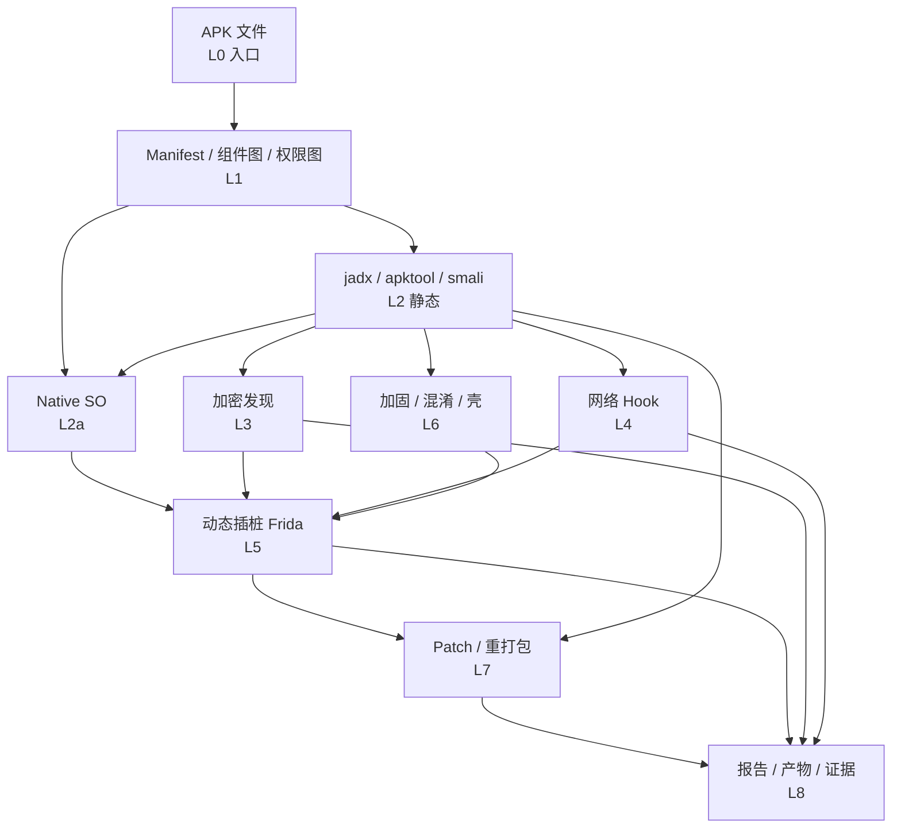

# APK 逆向攻击网（分叉决策图）

> **来源**：改编自 `LING71671/open-reverselab` 的 `kb/apk-reverse/techniques/attack-network.md`
> **什么时候用**：拿到 APK 后不知道该走哪条路 —— 用这张分叉图决定从哪个入口进、下一步跳到哪。

## 核心思路

线性分析链（APK → jadx → 报告）不够。实际是**多入口、多分叉、跨分类交织的图**：每个节点是一个分析动作，每条边是一次工具操作或一个发现。

**不要线性思考，要网状思考**：

```
错: APK → jadx → report
对: APK → jadx → crypto → Frida → dump → re-analyze → patch → repack
```

## 分层结构



## 关键枢纽节点

| 节点 | 作用 |
|---|---|
| `jadx` | Java 层静态入口，发现加密/网络/native 入口 |
| `Native/SO` | SO 分析必经之路 |
| `Frida` | 动态分析核心，连接静态发现 → 动态验证 → 数据 dump |
| `Smali` | Java 层 patch 的中转站 |
| `Crypto 发现` | 加密算法识别 → hook → dump |
| `Repack` | patch 最终输出前的组装节点 |

## 典型路径

### 路径 1：标准 APK 逆向

```
APK → jadx → Java 类分析
  ├─ → javax.crypto → Cipher.doFinal 打点 → Frida hook → 解密数据
  ├─ → OkHttp → 请求/响应 hook → Frida → 协议格式
  └─ → System.loadLibrary → libtarget.so → IDA/r2 → SO 分析 → native hook
```

### 路径 2：游戏（外挂分析视角）

```
APK → jadx → libil2cpp.so / libUE4.so → 偏移发现
  → Frida attach → 内存读写 → 指针链
    ├─ → 坐标/属性读取
    └─ → SO 注入 → 重打包 → 签名 → adb install → 验证
```

### 路径 3：脱壳

```
APK → jadx → 多 dex / DexClassLoader → 检测到加固
  → Frida spawn → 早期 ClassLoader hook → dump 所有 dex
  → 对 lib*.so 跑 DiE → UPX/OLLVM 判定
  → Frida hook dlopen → dump 运行时解密后的 SO
  → jadx + IDA 重新分析 dump 产物
```

### 路径 3.1：VMP/dex2c（加固形态特殊，路线不同）

```
APK → jadx → 目标方法空/nop/stub
  → vmp-dex2c-detection：so 特征 + dispatch 扫描 → 判定形态
  → dump 摸底 → 目标方法仍无 CodeItem → VMP 确认，dump 路线终止
  → vmp-anti-debug-bypass：过 TracerPid/双进程/时间检测
  → vmp-dump-trace-recovery：trace 解释器 dispatch
  → handler 映射表 → 字节码翻译为伪代码 → 等价性验证
```

### 路径 4：在线验证绕过

```
APK → jadx → OkHttp/Retrofit → verify 端点
  → Frida hook → 拦截验证响应 → 返回 true
  ├─ smali modify：验证分支恒真
  ├─ hook HTTP 响应注入 {"valid": true}
  └─ 去掉 SSL pinning → 代理 → 观察
```

### 路径 5：协议逆向

```
APK → jadx → Retrofit 接口方法 / protobuf 字段名
  → Frida hook Protobuf.SerializeToByteArray → 拿原始字节
  → Frida hook Socket.send/recv → 全量封包
  → 分析字段结构 → protobuf 文档
```

### 路径 6：SO 注入 + 功能修改

```
APK → apktool d → lib/<abi>/libtarget.so → 分析
  → 写 inject.so
  → 放入 lib/ + smali 加 System.loadLibrary("inject")
  → 必要时改 AndroidManifest 权限
  → apktool b → 签名 → adb install → 验证
```

### 路径 7：重打包后完整性恢复

```
smali/native patch → apktool b → 签名 → 启动崩溃
  → hook getPackageInfo / MessageDigest / open(base.apk)
  → 定位签名/hash/installer 检查
  → patch 比较分支或返回原始摘要 → 重装 → 功能复验
```

## 隐性连接（容易被忽略）

```
APK → 内嵌 assets → HTML/JS → WebView XSS → token 泄露
Frida → hook libc fopen → 记录文件 IO → 找到隐藏配置文件/密钥
smali 注入 → 动态加载自建 SO → 绕过完整性检查
AndroidManifest → exported provider → 数据泄露
```

## 驱动决策

```
拿到 APK 后:
1. jadx 打开 → 读 AndroidManifest → 看 exported 组件 / 权限
2. 查这张图 → 从哪个入口进？
3. 有 crypto？     → crypto 路径 → Frida hook → dump
4. 有 OkHttp/Retrofit？ → network 路径 → 协议逆向
5. 有 libil2cpp/libUE4？ → native 路径 → 偏移发现
6. 有多 dex / ClassLoader / 加固？ → packer 路径 → 切 Frida spawn
7. 目标是 patch？  → 从 smali 入口 → 注入 → 重打包 → 签名
8. 目标只是分析？ → 从任意分叉进入 → 证据 → 报告
```

## 节点执行口径

每个节点按同一格式推进：

```text
入口信号: Manifest、类名、方法签名、SO 名称、字符串、import 或运行时日志
打点动作: jadx/apktool/IDA/r2/Frida/adb 中的具体命令或脚本
成功标志: hook 命中、明文出现、dex/so dump、patch 生效、repack 可安装运行
下一跳: Java / Native / Crypto / Network / Packer / Patch / 报告
证据: 包名、组件、偏移、hook 输出、dump 路径、patch diff、运行日志
```

**如果某条路径只拿到类名或字符串，先把它转成可执行打点**：Frida hook、IDA xref、OkHttp interceptor、`dlopen`/`RegisterNatives` 追踪或 smali patch。每轮输出都要能被下一轮直接消费。

## 本技能包的工具映射

| 动作 | 工具（探测层 id） |
|---|---|
| 解包 / 反编译 | `apktool` / `jadx` |
| Manifest 组件 | `aapt2` |
| DEX 字节码 | `dexdump`（build-tools 34.0.0） |
| SO 结构 | `so-structure-audit.py`（本技能包脚本） |
| 加固判定 | `diec` + `find-vm-dispatch.py` |
| so 反编译 | `idat64_83`（IDA 8.3 Portable）/ `analyzeHeadless` |
| 动态 hook | `frida` / `objection` |
| 重打包签名 | `zipalign` / `apksigner` |
| 安装 | `adb` |

取路径一律先 `. C:\relab2\skillpack\skills\scripts\lib\Bootstrap.ps1` 再 `Resolve-ReverseToolSpec`。

## 坑

- **别把「构建成功」当分析完成**：判据必须是外部可观测的（hook 命中、解出明文、复验通过）。
- **加固 APK 的 jadx 输出常是空壳**：先跑 `smali-stub-ratio.py` 判定形态再决定路线，否则会浪费大量时间在读 stub 上。
- **多 dex 应用**：`jadx` 会合并输出，但 `apktool` 会分 `smali_classes2/` 等目录，patch 时别改错目录。
- **ASLR/PIE**：运行时地址不能直接当静态地址，见 `native/jni-register-natives-tracing.md` 的归一化规则。

## 相关

- `smali-stub-ratio.py` / `find-vm-dispatch.py` / `so-structure-audit.py` —— 本技能包 `scripts/` 下的三个判定脚本
- `apk-reverse-index.md` —— 本库全部篇目索引
