# Web 攻击网

> **来源**：改编自 `LING71671/open-reverselab` 的 `kb/ctf-website/techniques/attack-network.md`（GPL-3.0）。原 frontmatter 的 `mcp_tools` 映射已剔除——本技能包未挂载 `run_ctf_tool` / `http_probe`，改用本地工具链。
> **能力域**：本文为技术能力说明，按项目 `scope.md` 直接套用。
> **什么时候用**：命中「见适用信号」这类信号时，把本文当打点清单读；命中即进「步骤」，命中不了就换主题。

## 适用信号

- 见下方「技术正文」的条目式打点清单（本文档正文以清单为主，无结构化信号表）。

## 前置

- 授权：目标在 scope 内（`case-init.ps1` 已 grant），测试时段与限速已约定。
- 工具定位走探测层，别猜路径：

```powershell
. 'C:\relab2\skillpack\skills\scripts\lib\Bootstrap.ps1'
$r = Resolve-ReverseToolSpec -Name '<toolid>'   # 例：sqlmap / httpx / ffuf / curl / python
& $r.Command <参数>                                # 永远用完整路径，不依赖 cwd
```

- Python 解释器用探测层的 `python`。
- 本文脚本默认只读、只打点；扩大范围前先回到 scope 确认。

## 步骤

本文正文按下列小节顺序推进，**每一步的完整命令与脚本在「技术正文」对应小节里**（这类文档以代码体 + 表格为主，按小节读比按 bullet 读快）：

1. 全网图 (Mermaid)
2. 典型攻击网路径
3. 路径 1: 从 XSS 到 Flag (Client→Credentials→Flag)
4. 路径 2: 从 SSRF 到 Flag (Network→Metadata→Cloud→Flag)
5. 路径 3: 从 SQLi 到 Flag (Injection→Credentials→RCE→Flag)
6. 路径 4: 从 LFI 到 Flag (File Read→Config→DB→Flag)
7. 路径 5: 从 CI/CD 到 Flag (Supply→Credentials→Cloud→Flag)
8. 路径 6: K8s Pod→Cloud
9. 路径 7: 从 Paywall 到 Flag (23-paywall-bypass)
10. 攻击网中的关键枢纽节点 — 这些节点被最多其他节点依赖，是攻击网中的 choke point：
11. 网中没画但存在的边 (隐性连接)
12. 攻击网驱动决策
13. 节点执行口径 — 每个节点都按同一格式推进：

## 判据

判据必须是外部可观测的（状态码、响应字段、差分、落盘文件），不是「命令有输出」。

- 复现同一请求两次，状态码 + 响应体 hash 必须稳定；不稳定说明是噪声源（时间戳/随机数/缓存），先校准 baseline。
- 判为命中的最低门槛：同一 session 下**只有被测变量不同**，业务字段（身份/订单状态/flag）发生可复现变化。

## 坑

- 探针命令在**未本机验证**时不要当成既定事实跑；先用探测层确认 `Available=True`。
- 噪声排除：先固定 baseline（同 URL 同 token 跑 3 次），再只改一个变量做差分。
- 不要把「状态码 200」当命中——WAF/缓存/软 404 都返回 200，命中判据要落到具体业务字段。

## 相关

- 见本技能 `../SKILL.md` 的 references 索引。

## 技术正文

> 以下为原库正文（保留全部技术细节与脚本），仅移除原 `MCP 工具映射` 章节并重写跨文档链接。

线性攻击链不够。攻击网 = 多入口、多分叉、跨分类交织的图结构。每个节点是一个 Primitive，每条边是一个攻击步骤。

## 全网图 (Mermaid)

```mermaid
graph TD
    %% === Layer 0: Entry Points ===
    XSS["XSS<br/>07-client"]
    SSRF["SSRF<br/>04-ssrf"]
    SQLI["SQLi<br/>03-injection"]
    LFI["LFI<br/>06-file"]
    UPLOAD["File Upload<br/>06-file"]
    DESER["Deserialize<br/>05-deser"]
    PP["Proto Pollution<br/>03-injection"]
    HOST["Host Header<br/>02-auth"]
    OAUTH["OAuth<br/>02-auth"]
    OPENREDIR["Open Redirect<br/>04-ssrf"]
    GRAPHQL["GraphQL<br/>03-injection"]
    WEBSOCKET["WebSocket<br/>07-client"]
    CORS["CORS<br/>07-client"]
    CRLF["CRLF/HPP<br/>03-injection"]
    DEPCONF["Dep Confusion<br/>11-supply"]
    GHA["GitHub Actions<br/>10-cloud"]
    GHA_ABUSE["GHA Abuse<br/>10-cloud"]
    LAMBDA["Lambda<br/>10-cloud"]
    POD["K8s Pod<br/>10-cloud"]
    K8SRBAC["K8s RBAC<br/>10-cloud"]
    CONTAINER["Container Runtime<br/>10-cloud"]
    TFSTATE["Terraform State<br/>10-cloud"]
    SAML["SAML<br/>02-auth"]
    JWT["JWT<br/>02-auth/jwt"]
    IDOR["IDOR/BAC<br/>14-idor"]
    API["API Discovery<br/>17-api-attacks"]
    MASSASSIGN["Mass Assignment<br/>15-mass-assignment"]
    RATELIMIT["Rate Limit Bypass<br/>16-rate-limit"]
    SUBTAKE["Subdomain Takeover<br/>19-dns-email"]
    REDOS["ReDoS<br/>03-injection"]
    PAYBY["Payment Bypass<br/>12-payment"]
    PRICE["Price Manip<br/>12-payment"]
    CALLBACK["Callback Forge<br/>12-payment"]
    SIGALG["Sign Alg Attack<br/>13-signature"]
    SIGIMPL["Sign Impl Bug<br/>13-signature"]
    SIGKEY["Sign Key Leak<br/>13-signature"]
    PAYWALL["Paywall Bypass<br/>23-paywall"]
    PAYWALL_UA["UA Spoof<br/>23-paywall"]
    PAYWALL_BLOCK["Script Block<br/>23-paywall"]
    PAYWALL_JSONLD["JSON-LD Extract<br/>23-paywall"]
    PAYWALL_ARCHIVE["Archive Proxy<br/>23-paywall"]

    %% === Layer 1: Credential / Info Leak ===
    CRED["Credential Leak<br/>session/token/key"]
    SRC["Source Leak<br/>config backup env"]
    IAM["IAM Credential<br/>AWS role token"]
    SATOKEN["SA Token<br/>K8s service account"]
    DB["Database Access<br/>read/write rows"]

    %% === Layer 2: Auth Bypass / Privilege ===
    ADMIN["Admin Access<br/>后台/管理面板"]
    BE["Backend RCE<br/>shell execution"]

    %% === Layer 3: Data / Flag ===
    FLAG["🏴 Flag"]

    %% --- Edges: Entry → Credential ---
    XSS -->|cookie steal| CRED
    XSS -->|localStorage| CRED
    XSS -->|CSRF token read| CRED
    SSRF -->|metadata| IAM
    SSRF -->|metadata| CRED
    SSRF -->|internal config| SRC
    LFI -->|config.php/.env| SRC
    LFI -->|/proc/self/environ| CRED
    LFI -->|shadow| CRED
    SQLI -->|user table| CRED
    SQLI -->|INFORMATION_SCHEMA| DB
    SQLI -->|LOAD_FILE| SRC
    HOST -->|reset email hijack| CRED
    OAUTH -->|redirect steal| CRED
    OAUTH -->|client secret| SRC
    CORS -->|cross-origin read| CRED
    CORS -->|ACAO:*+creds| CRED
    OPENREDIR -->|OAuth code steal| CRED
    POSTMESSAGE["PostMessage<br/>07-client"]
    POSTMESSAGE -->|token leak| CRED
    DEPCONF -->|CI env steal| CRED
    DEPCONF -->|~/.aws/creds| IAM
    GHA -->|workflow injection| CRED
    GHA -->|GITHUB_TOKEN| SRC
    GHA_ABUSE -->|OIDC trust| IAM
    GHA_ABUSE -->|artifact/cache leak| SRC
    LAMBDA -->|env vars| IAM
    POD -->|SA token mount| SATOKEN
    POD -->|kubelet| SATOKEN
    POD -->|etcd| SRC
    K8SRBAC -->|can-i secrets/get| CRED
    K8SRBAC -->|pods/exec| ADMIN
    K8SRBAC -->|serviceaccounts/token| SATOKEN
    CONTAINER -->|docker.sock| BE
    CONTAINER -->|hostPath/privileged| BE
    TFSTATE -->|outputs/secrets| CRED
    TFSTATE -->|resource topology| SRC
    SAML -->|NameID forge| CRED
    SAML -->|attribute inject| ADMIN
    JWT -->|alg none/confusion| CRED
    JWT -->|kid/jku key abuse| ADMIN
    IDOR -->|object id enumerate| DB
    IDOR -->|horizontal access| CRED
    API -->|swagger/openapi leak| SRC
    API -->|unauth endpoint| DB
    MASSASSIGN -->|role/isAdmin overwrite| ADMIN
    MASSASSIGN -->|price/quota overwrite| FLAG
    RATELIMIT -->|bruteforce token/otp| CRED
    RATELIMIT -->|coupon/order race| FLAG
    SUBTAKE -->|dangling CNAME takeover| CRED
    SUBTAKE -->|trusted origin control| XSS
    REDOS -->|auth bypass| ADMIN
    REDOS -->|WAF bypass| BE
    WEBSOCKET -->|CSWSH| CRED

    %% --- Edges: Payment → Direct Flag ---
    PAYBY -->|zero amount| FLAG
    PAYBY -->|state bypass| FLAG
    PAYBY -->|mass assignment| FLAG
    PRICE -->|type confusion| FLAG
    PRICE -->|precision attack| FLAG
    PRICE -->|currency exploit| FLAG
    CALLBACK -->|signature forge| FLAG
    CALLBACK -->|idempotency race| FLAG
    CALLBACK -->|replay attack| FLAG
    %% --- Edges: Payment → Credential/Admin ---
    PAYBY -->|coupon steal| CRED
    CALLBACK -->|webhook SSRF| IAM
    CALLBACK -->|notify_url SSRF| SRC
    CALLBACK -->|internal notify| ADMIN
    PRICE -->|coupon abuse| CRED

    %% --- Edges: Signature → Everything ---
    SIGALG -->|alg downgrade| CALLBACK
    SIGALG -->|none alg| JWT
    SIGIMPL -->|strcmp bypass| CALLBACK
    SIGIMPL -->|type juggling| PAYBY
    SIGKEY -->|JMK leak| JWT
    SIGKEY -->|secret leak| CALLBACK
    SIGKEY -->|.env leak| SRC

    %% --- Edges: Info → Admin ---
    CRED -->|session reuse| ADMIN
    CRED -->|JWT forge| ADMIN
    CRED -->|API key| ADMIN
    SRC -->|hardcoded password| ADMIN
    SRC -->|DB password| DB
    SRC -->|encryption key| CRED
    IAM -->|AWS CLI| ADMIN
    IAM -->|sts:AssumeRole| ADMIN
    IAM -->|PassRole/Lambda| ADMIN
    SATOKEN -->|kubectl| ADMIN
    DB -->|admin hash crack| ADMIN

    %% --- Edges: Admin → RCE ---
    ADMIN -->|upload webshell| BE
    ADMIN -->|template edit| BE
    ADMIN -->|plugin install| BE
    SSRF -->|Gopher Redis| BE
    SSRF -->|Docker API| BE
    SSRF -->|FastCGI| BE
    DESER -->|gadget chain| BE
    PP -->|child_process| BE
    PP -->|EJS/Pug| BE
    SSTI["SSTI<br/>03-injection"]
    SSTI -->|subprocess| BE
    GRAPHQL -->|SQLi via arg| BE
    CRLF -->|Redis injection| BE
    LAMBDA -->|Runtime API| BE
    POD -->|runc escape| BE
    POD -->|privileged pod| BE
    K8SRBAC -->|create pod| POD
    CONTAINER -->|runtime escape| BE

    %% --- Edges: RCE → Flag ---
    BE -->|cat /flag| FLAG
    BE -->|read env| FLAG
    DB -->|SELECT flag| FLAG
    SRC -->|flag in config| FLAG
    IAM -->|aws s3 cp| FLAG
    SATOKEN -->|kubectl exec cat| FLAG

    %% --- Edges: Paywall → Direct Flag ---
    PAYWALL -->|UA spoof| FLAG
    PAYWALL -->|JSON-LD| FLAG
    PAYWALL -->|archive.is| FLAG
    PAYWALL -->|DOM manip| FLAG
    PAYWALL_UA -->|Googlebot| FLAG
    PAYWALL_BLOCK -->|SDK block| FLAG
    PAYWALL_JSONLD -->|articleBody| FLAG
    PAYWALL_ARCHIVE -->|cached content| FLAG

    %% --- Cross-category edges ---
    XSS -.->|admin bot| SSRF
    XSS -.->|admin bot| BE
    OPENREDIR -.->|chain to| SSRF
    CRLF -.->|smuggling| SSRF
    LFI -.->|log poison| BE
    UPLOAD -.->|xxe| SSRF
    UPLOAD -.->|php shell| BE
    SQLI -.->|stacked| UPLOAD
    SQLI -.->|dblink| SSRF
    CORS -.->|token read| XSS
    WEBSOCKET -.->|message inject| SQLI
    GRAPHQL -.->|field suggest| SQLI
    REDOS -.->|event loop block| ADMIN
    HOST -.->|header inject| CRLF
    SAML -.->|XSW bypass| ADMIN
```



## 典型攻击网路径

### 路径 1: 从 XSS 到 Flag (Client→Credentials→Flag)
```
XSS → cookie steal → Session hijack → Admin panel → Template edit → RCE → Flag
  ├─ alt: XSS → CSRF token read → POST /admin/createUser → Backdoor admin
  ├─ alt: XSS → localStorage → JWT → forge claims → API abuse → Data exfil
  └─ alt: XSS → admin bot → SSRF → metadata → IAM → aws s3 → Flag
```

### 路径 2: 从 SSRF 到 Flag (Network→Metadata→Cloud→Flag)
```
SSRF → 169.254.169.254 → IAM credential → AWS CLI
  ├─ → s3:ListBuckets → s3:GetObject → Flag
  ├─ → lambda:UpdateFunctionCode → Backdoor Lambda → steal events
  └─ → sts:AssumeRole → cross-account → more resources
```

### 路径 3: 从 SQLi 到 Flag (Injection→Credentials→RCE→Flag)
```
SQLi → users table → admin hash → crack → login
  ├─ → upload webshell → RCE → Flag
  ├─ → template edit → SSTI → Flag
  └─ → SQLi → LOAD_FILE('/flag') → Flag (direct)
```

### 路径 4: 从 LFI 到 Flag (File Read→Config→DB→Flag)
```
LFI → /var/www/.env → DB_PASSWORD → mysql connect
  ├─ → SELECT flag FROM flags → Flag
  ├─ → LFI → /proc/self/environ → API_KEY → API abuse → Flag
  └─ → LFI → log poison → RCE → Flag
```

### 路径 5: 从 CI/CD 到 Flag (Supply→Credentials→Cloud→Flag)
```
GitHub Actions injection → GITHUB_TOKEN → push to main
  ├─ → deploy pipeline → AWS creds → s3 → Flag
  ├─ → npm publish malicious version → downstream → all customers
  └─ → self-hosted runner → metadata → IAM → everything
```

### 路径 6: K8s Pod→Cloud
```
Pod RCE → /var/run/secrets/kubernetes.io/serviceaccount/token
  ├─ → RBAC create privileged pod → hostPath / → node RCE → metadata → IAM
  ├─ → kubelet:10250 → exec in other pods → steal their SA tokens
  └─ → etcd:2379 → read all secrets → DB passwords → Flag
```

### 路径 7: 从 Paywall 到 Flag (23-paywall-bypass)
```
Paywall 识别 → 指纹 CMS/Paywall 服务
  ├─ → UA 伪装 (Googlebot) + Cookie 清除 → 服务器直接返回全文 → Flag
  ├─ → declarativeNetRequest block → 阻止 paywall SDK → 正文自然可见 → Flag
  ├─ → JSON-LD extraction → <script> articleBody → DOMPurify 注入 → Flag
  ├─ → archive.is proxy → fetch 缓存页面 → .TEXT-BLOCK 提取 → Flag
  └─ → DOM/CSS 操作 → 移除 overlay + 恢复正文 → Flag
```

## 攻击网中的关键枢纽节点

这些节点被最多其他节点依赖，是攻击网中的 choke point：

| 节点 | 入度 | 出度 | 说明 |
|------|------|------|------|
| `Credential Leak` | 12 | 3 | 几乎所有攻击面都可以泄露凭证 |
| `Admin Access` | 8 | 3 | 提权到管理员的必经之路 |
| `Backend RCE` | 11 | 1 | 最终执行的关键节点 |
| `Source Leak` | 7 | 3 | 配置/源码泄露 → DB密码/密钥 |
| `SSRF` | 5 | 4 | 从外网打到内网的核心桥梁 |

## 网中没画但存在的边 (隐性连接)

```
Timing Attack → HMAC key → JWT → Admin API
  (timing 逐字节恢复 → JWT forge → 管理接口)

Dependency Confusion → CI build → .env → DB → SELECT flag
  (供应链入口 → CI环境 → 配置窃取 → 数据库 → flag)

ReDoS → Node.js block → Auth bypass → Admin → Flag
  (正则回溯卡住线程 → 认证请求不处理 → 未认证请求通过)

PostMessage → OAuth token → Account takeover → Flag
  (跨域消息 → 窃取token → 接管账号 → flag)

Web Cache Deception → /account.json → cached PII → Flag
  (缓存欺骗 → 敏感数据缓存 → 无认证读取)

Cache Poisoning → JS hijack → XSS → Cookie steal → Flag
  (unkeyed header → 缓存恶意JS → 全站XSS → 凭证窃取)

Paywall → UA spoof → Recon → Fingerprint → CVE
  (Googlebot UA 获取完整HTML → 发现隐藏API端点 → CVE链)

Paywall → JSON-LD → info leak → API key → Admin
  (提取完整JSON → 发现内部endpoint → 密钥泄露 → 提权)
```

## 攻击网驱动决策

```
拿到 target 后:
1. 指纹 → 确认技术栈
2. 查攻击网 → 哪些 Entry 适合这个技术栈?
3. 对每个可用 Entry → 看它指向哪些 Credential/Info 节点
4. 从 Credential → 看通向 Admin/RCE 的路径
5. 从 RCE → 直接 Flag 或再收敛

不要线性思考 "A→B→C→Flag"
而要网状思考 "从 A 可以到 B C D，B 可以到 E F，C 可以到 G H..."
选最短路径，同时备份备选路径。
```

## 节点执行口径

每个节点都按同一格式推进：

```text
入口信号: 从响应、源码、配置、日志或工具输出里看到什么
打点动作: 运行哪段脚本、哪条命令、哪个 MCP 工具
成功标志: 响应差异、凭证可用、权限变化、文件可读、Flag 出现
下一跳: Credential / Source / Admin / RCE / DB / Cloud / Flag 中的哪个节点
Evidence: 请求、响应、payload 变量、listener 日志、工具输出和落盘路径
```

如果一个入口没有产生下一跳，把失败样本也写入 Tried / Ruled-out，说明卡在解析、权限、过滤、异步窗口还是业务状态机。这样攻击网可以继续从旁路分叉，而不是在单一路径上空转。
