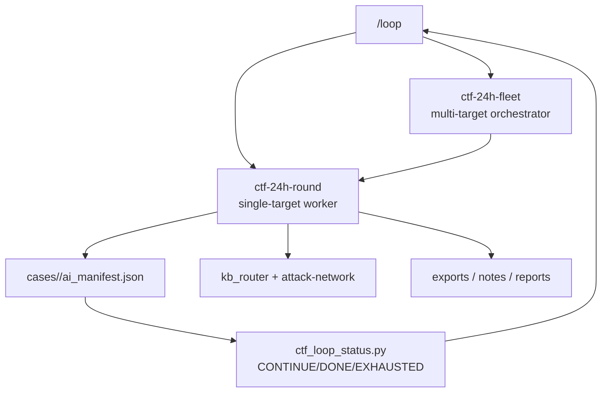

# 24h Loop Orchestration

> **来源**：改编自 `LING71671/open-reverselab` 的 `kb/ctf-website/techniques/00-workflow/24h-loop-orchestration.md`（GPL-3.0）。原 frontmatter 的 `mcp_tools` 映射已剔除——本技能包未挂载 `run_ctf_tool` / `http_probe`，改用本地工具链。
> **授权范围**：仅限 CTF 靶场 / AWD 赛场 / 已签署授权的测试环境。任何真实第三方目标、真实凭据、真实支付/生产流量都禁止套用本文流程。
> **什么时候用**：命中「见适用信号」这类信号时，把本文当打点清单读；命中即进「步骤」，命中不了就换主题。

## 适用信号

本篇是清单/索引类文档，正文直接以条目给出打点项（见「技术正文」首节）：

- `autopilot.rounds[]`
- `next_round_focus[]`
- `attack_paths[]`
- `evidence[]`
- `dead_ends[]`
- 全部 DONE -> `DONE`
- 全部 EXHAUSTED -> `EXHAUSTED`
- 其余 -> `CONTINUE`

## 前置

- 授权：目标在 scope 内（`case-init.ps1` 已 grant），测试时段与限速已约定。
- 工具定位走探测层，别猜路径：

```powershell
. 'C:\relab2\skillpack\skills\scripts\lib\Bootstrap.ps1'
$r = Resolve-ReverseToolSpec -Name '<toolid>'   # 例：sqlmap / httpx / ffuf / curl / python
& $r.Command <参数>                                # 永远用完整路径，不依赖 cwd
```

- Python 解释器用探测层的 `python`（本机逆向库集中在 `D:\EXE\python\python.exe`，`venv-re` 是空壳，别去那里找库）。
- 本文脚本默认只读、只打点；扩大范围前先回到 scope 确认。

## 步骤

本文正文按下列小节顺序推进，**每一步的完整命令与脚本在「技术正文」对应小节里**（这类文档以代码体 + 表格为主，按小节读比按 bullet 读快）：

1. 单目标 Round — 1. 读取 ai_manifest.json。
2. 多目标 Fleet — 多个网站不要共用一个 manifest。fleet 只负责调度：
3. 每轮攻击路径选择 — 1. 已确认可达 target + 已有参数/表单/API。
4. 工作流闭环 — 每轮必须保持“小步可恢复”：如果网络、目标、工具或登录态失败，只把该路径写入
5. 状态语义

## 判据

判据必须是外部可观测的（状态码、响应字段、差分、落盘文件），不是「命令有输出」。

- **7. 证据与验证标准** — `evidence[]` 新增了可复查条目，包含命令、请求、响应摘要、截图路径或产物路径。
- **7. 证据与验证标准** — `dead_ends[]` 记录了失败路径和失败原因，能解释为什么暂不继续该分支。
- **7. 证据与验证标准** — `next_actions[]` 明确列出下一轮可执行动作，不只写“继续测试”。
- **7. 证据与验证标准** — `ctf_loop_status.py --write` 已更新 manifest 状态，并能输出 `STATUS:` 行。

## 坑

- 探针命令在**未本机验证**时不要当成既定事实跑；先用探测层确认 `Available=True`。
- 噪声排除：先固定 baseline（同 URL 同 token 跑 3 次），再只改一个变量做差分。
- 不要把「状态码 200」当命中——WAF/缓存/软 404 都返回 200，命中判据要落到具体业务字段。

## 相关

- 见本技能 `../../SKILL.md` 的 references 索引。

## 技术正文

> 以下为原库正文（保留全部技术细节与脚本），仅移除原 `MCP 工具映射` 章节并重写跨文档链接。

面向 Claude Code / Codex 的 24 小时无人值守 Web CTF 工作流编排。目标是让
workflow 循环、checkpoint 和 KB 攻击路径形成闭环，而不是靠单次提示词长跑。

## 1. 架构



## 2. 单目标 Round

每轮执行：

1. 读取 `ai_manifest.json`。
2. 跑 `ctf_autopilot.py` 一轮，执行 allowlist 动作。
3. 对 `agent_required` 动作按攻击网选择 1-2 条路径深入。
4. 每发现信号，立即：
   ```bash
   python3 scripts/ctf-website/kb_router.py "<signal>"
   ```
5. 写回：
   - `autopilot.rounds[]`
   - `next_round_focus[]`
   - `attack_paths[]`
   - `evidence[]`
   - `dead_ends[]`
6. 运行：
   ```bash
   python3 scripts/ctf-website/ctf_loop_status.py cases/<case>/ai_manifest.json --write
   ```

## 3. 多目标 Fleet

多个网站不要共用一个 manifest。fleet 只负责调度：

| 层级 | 产物 |
|---|---|
| Fleet | `reports/ctf-website/<fleet>/fleet-round-*.md` |
| Target A | `cases/<fleet>-<target-a>/ai_manifest.json` |
| Target B | `cases/<fleet>-<target-b>/ai_manifest.json` |

调度策略：

1. 每轮按 `batchSize` 并行调用多个 `ctf-24h-round`。
2. 每个 target 独立输出 `STATUS`。
3. fleet 状态：
   - 全部 DONE -> `DONE`
   - 全部 EXHAUSTED -> `EXHAUSTED`
   - 其余 -> `CONTINUE`

## 4. 每轮攻击路径选择

优先级排序：

1. 已确认可达 target + 已有参数/表单/API。
2. 有 KB 精确匹配的信号：JWT、SQLi、SSRF、LFI、SSTI、CVE、IDOR、API key。
3. 能通向枢纽节点的路径：Credential Leak / Source Leak / DB / Admin / Backend RCE。
4. 上轮未验证、且未进入 `dead_ends[]` 的路径。
5. 低成本 recon：路由、JS endpoint、fingerprint、CVE graph。

每轮深入多少条路径由 workflow 参数决定；未设置时按所有可用高价值路径推进。

## 5. 工作流闭环

```text
manifest 恢复点
  -> ctf_autopilot.py 执行有界动作
  -> Agent 按 attack-network 选择分支
  -> kb_router / kb_read_file 读取技术文件
  -> MCP 工具或脚本产生证据
  -> 写回 evidence / dead_ends / next_actions
  -> ctf_loop_status.py 输出 CONTINUE / DONE / EXHAUSTED
```

每轮必须保持“小步可恢复”：如果网络、目标、工具或登录态失败，只把该路径写入
`dead_ends[]` 或 `next_actions[]`，不要重置 manifest，也不要丢弃已有证据。

## 6. 状态语义

| 状态 | 含义 |
|---|---|
| `CONTINUE` | 仍有 `next_round_focus` / `next_actions` / pending hypotheses |
| `DONE` | `evidence[]` 中记录 flag/solve 证据 |
| `EXHAUSTED` | 全部路径证据化失败、目标长期不可达或关键依赖缺失且无替代路径 |

## 7. 证据与验证标准

每轮完成前至少满足一项：

- `evidence[]` 新增了可复查条目，包含命令、请求、响应摘要、截图路径或产物路径。
- `dead_ends[]` 记录了失败路径和失败原因，能解释为什么暂不继续该分支。
- `next_actions[]` 明确列出下一轮可执行动作，不只写“继续测试”。
- `ctf_loop_status.py --write` 已更新 manifest 状态，并能输出 `STATUS:` 行。

如果声称 `DONE`，必须有 flag、解题证明、关键响应、截图或报告路径；如果声称
`EXHAUSTED`，必须列出已覆盖的攻击路径和阻塞证据。

## 8. MCP 工具映射

| 步骤 | MCP / 脚本 |
|---|---|
| 初始化 case | `ctf_intake.py` / `ctf_new_challenge` |
| 单轮 checkpoint | `ctf_autopilot.py` / `ctf_autopilot_round` |
| 状态判定 | `ctf_loop_status.py` |
| KB 路由 | `kb_router` |
| HTTP baseline | `http_probe` |
| SQLi request replay | `ctf_save_request` + `run_sqlmap_request` |
| CVE graph/chain | `fingerprint_cve_pipeline.py` |
