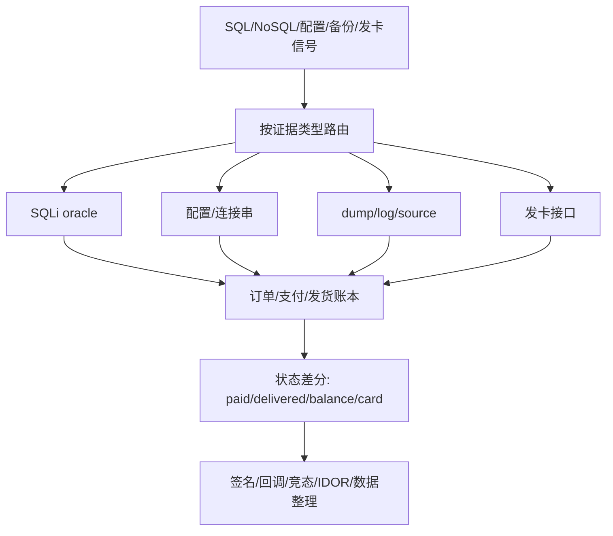

# Database Attack Surface — 数据库攻击全景与决策树

> **来源**：改编自 `LING71671/open-reverselab` 的 `kb/ctf-website/techniques/24-database/00-overview.md`（GPL-3.0）。原 frontmatter 的 `mcp_tools` 映射已剔除——本技能包未挂载 `run_ctf_tool` / `http_probe`，改用本地工具链。
> **能力域**：本文为技术能力说明，按项目 `scope.md` 直接套用。
> **什么时候用**：命中「见适用信号」这类信号时，把本文当打点清单读；命中即进「步骤」，命中不了就换主题。

## 适用信号

本篇是清单/索引类文档，正文直接以条目给出打点项（见「技术正文」首节）：

- 本篇（SQL/NoSQL 注入） — SQL/NoSQL 注入
- [[01-sqli-fundamentals]] — IDOR 与数据库枚举
- 无对应文档，已删除 — PHP 支付与数据库交互
- 无对应文档，已删除 — 文件读写与数据库配置
- [[07-data-cleaning]] — dump/log/HTML/JSON 数据整理

## 前置

- 授权：目标在 scope 内（`case-init.ps1` 已 grant），测试时段与限速已约定。
- 工具定位走探测层，别猜路径：

```powershell
. 'C:\relab2\skillpack\skills\scripts\lib\Bootstrap.ps1'
$r = Resolve-ReverseToolSpec -Name '<toolid>'   # 例：sqlmap / httpx / ffuf / curl / python
& $r.Command <参数>                                # 永远用完整路径，不依赖 cwd
```

- Python 解释器用探测层的 `python`。
- 本文脚本默认只读、只打点；扩大范围前先回到 scope 确认。

## 步骤

本文正文按下列小节顺序推进，**每一步的完整命令与脚本在「技术正文」对应小节里**（这类文档以代码体 + 表格为主，按小节读比按 bullet 读快）：

1. 攻击面全景
2. 速查决策树
3. 技术升格路线 — 数据库板块不要按“漏洞名”线性推进，而要按证据类型切换打法：
4. 订单/支付闭环路线图 — 数据库板块和支付板块的交叉点是账本：订单表、支付流水、发货记录、卡密表、余额变更、回调日志。任意入口命中后都要尽快路由到这些账本，而不是停在“拿到一段数据”。
5. 路由器伪代码
6. 攻击链 / 工作流
7. 关联技术

## 判据

判据必须是外部可观测的（状态码、响应字段、差分、落盘文件），不是「命令有输出」。

- **已知证据** — SQL 报错栈
- **已知证据** — 页面有 True/False 差异
- **已知证据** — WAF 拦关键词
- **已知证据** — 写入后另一路触发
- **已知证据** — JSON body 可传对象
- **已知证据** — Redis/ES/CouchDB 响应
- **已知证据** — `.env`/源码可读
- **已知证据** — `.sql`/日志命中
- **已知证据** — 发卡接口/卡密字段
- **已知证据** — 混合泄露数据
- **证据类型** — HTTP 证据
- **证据类型** — 数据库指纹
- **证据类型** — 文件泄露
- **证据类型** — 权限边界

## 坑

- 探针命令在**未本机验证**时不要当成既定事实跑；先用探测层确认 `Available=True`。
- 噪声排除：先固定 baseline（同 URL 同 token 跑 3 次），再只改一个变量做差分。
- 不要把「状态码 200」当命中——WAF/缓存/软 404 都返回 200，命中判据要落到具体业务字段。

## 相关

- 见本技能 `../../SKILL.md` 的 references 索引。

## 技术正文

> 以下为原库正文（保留全部技术细节与脚本），仅移除原 `MCP 工具映射` 章节并重写跨文档链接。

> 数据库是 Web 应用的核心资产——SQL 注入、NoSQL 滥用、配置泄露、备份暴露、发卡平台 CDK 泄露。本指南提供系统化的攻击面导航与决策路径。

## 关键词

`SQL注入` `NoSQL注入` `数据库脱库` `数据泄露` `SQLi` `blind injection` `error-based` `time-based` `OOB` `WAF绕过` `宽字节注入` `二次注入` `order by注入` `load_file` `into outfile` `默认密码` `数据库备份` `连接字符串泄露` `ORM注入` `PDO` `MySQL` `PostgreSQL` `MongoDB` `Redis` `Elasticsearch`

## 攻击面全景

```
数据库攻击面:
┌──────────────────────────────────────────────────────┐
│  应用层                                              │
│  ├─ SQL 注入 (SELECT/INSERT/UPDATE/DELETE/ORDER BY)  │
│  ├─ NoSQL 注入 (MongoDB/Redis/CouchDB)               │
│  ├─ ORM 注入 (HQL/JPQL/DQL)                          │
│  ├─ 二阶注入 (Stored XSS → SQLi)                     │
│  └─ 盲注 (Boolean/Time/Error/OOB)                    │
├──────────────────────────────────────────────────────┤
│  配置层                                              │
│  ├─ 数据库端口暴露 (3306/5432/27017/6379)             │
│  ├─ 默认凭证 (root:root/sa:sa/admin:admin)           │
│  ├─ 连接字符串泄露 (.env/config.php/web.config)      │
│  └─ 弱密码 + 暴力破解                                 │
├──────────────────────────────────────────────────────┤
│  运维层                                              │
│  ├─ 备份文件暴露 (.sql/.dump/.tar.gz/.zip)           │
│  ├─ phpMyAdmin/Adminer 未授权访问                     │
│  ├─ 日志泄露 (SQL query log/general_log)              │
│  └─ 安装文件残留 (install.sql/install.lock)          │
├──────────────────────────────────────────────────────┤
│  数据层                                              │
│  ├─ 数据库内网可达 (SSRF → RDS)                       │
│  ├─ 数据库复制/订阅泄露                               │
│  ├─ 存储过程/函数滥用 (xp_cmdshell/LOAD_FILE)         │
│  └─ 数据库链接/外部表 (dblink/postgres_fdw)          │
└──────────────────────────────────────────────────────┘
```

## 文档索引

| 文档 | 内容 |
|------|------|
| [01-sqli-fundamentals.md](01-sqli-fundamentals.md) | SQL 注入基础：类型、探测、利用 |
| [02-sqli-advanced.md](02-sqli-advanced.md) | 高级 SQLi：WAF绕过、二阶注入、OOB |
| [03-nosql-injection.md](03-nosql-injection.md) | NoSQL 注入：MongoDB、Redis、Elasticsearch |
| [04-config-exposure.md](04-config-exposure.md) | 数据库配置泄露与默认凭证 |
| [05-backup-log-leak.md](05-backup-log-leak.md) | 备份/日志文件暴露 |
| [06-card-platform.md](06-card-platform.md) | 发卡平台数据库攻击实战 |
| [07-data-cleaning.md](07-data-cleaning.md) | dump/log/HTML/JSON 泄露数据整理与实体映射 |

## 速查决策树

```
发现数据库相关信号:
├─ URL 参数/表单出现 SQL 错误 → [01] SQL 注入基础
│  ├─ 有详细报错 → Error-based 注入
│  ├─ 无报错但页面行为变化 → Boolean blind
│  └─ 无任何可见变化 → Time-based blind / OOB
├─ WAF 拦截 SQL 关键词 → [02] WAF 绕过技术
├─ 发现 NoSQL 端点 → [03] NoSQL 注入
├─ 发现 .env/config.php 可读 → [04] 配置泄露
├─ 发现 .sql/.dump 文件 → [05] 备份暴露
├─ 发卡/电商平台 → [06] 平台专项攻击
└─ 混合 dump/日志/HTML 泄露 → [07] 数据整理与实体映射
```

## 技术升格路线

数据库板块不要按“漏洞名”线性推进，而要按证据类型切换打法：

| 已知证据 | 立即判断 | 进入文档 | 下一步 |
|---|---|---|---|
| SQL 报错栈 | DBMS/闭合方式/查询上下文 | [01](01-sqli-fundamentals.md) | UNION/Error/Boolean/Time |
| 页面有 True/False 差异 | 可控表达式已执行 | [01](01-sqli-fundamentals.md) | 二分抽取、排序差异 |
| WAF 拦关键词 | 过滤层在 SQL parser 前 | [02](02-sqli-advanced.md) | HTTP/编码/AST 分层变形 |
| 写入后另一路触发 | 二阶注入 | [02](02-sqli-advanced.md) | 写入点/触发点状态机 |
| JSON body 可传对象 | NoSQL operator 注入 | [03](03-nosql-injection.md) | `$ne`/`$regex`/`$where` |
| Redis/ES/CouchDB 响应 | NoSQL 服务可达 | [03](03-nosql-injection.md) | key/index/db 枚举 |
| `.env`/源码可读 | 连接字符串/凭据 | [04](04-config-exposure.md) | 登录 DB 或反推注入点 |
| `.sql`/日志命中 | Schema/数据/SQL 模板 | [05](05-backup-log-leak.md) | dump 解析、日志反推 |
| 发卡接口/卡密字段 | 订单/发货/支付链 | [06](06-card-platform.md) | query/order/callback |
| 混合泄露数据 | 字段/实体/置信度 | [07](07-data-cleaning.md) | CSV/SQLite 索引 |

每条路线都保留成功样本和失败样本：失败样本能告诉你卡在 HTTP parser、WAF、SQL parser、权限、文件系统还是业务逻辑。

## 订单/支付闭环路线图

数据库板块和支付板块的交叉点是账本：订单表、支付流水、发货记录、卡密表、余额变更、回调日志。任意入口命中后都要尽快路由到这些账本，而不是停在“拿到一段数据”。



| 入口 | 最小可复查结果 | 继续转向 |
|---|---|---|
| SQLi | `orders/pay_log/cards` 关键行 | 支付状态机、回调重放 |
| NoSQL | session/cart/order/queue key | 登录态、异步发货 |
| 配置 | DB/Redis/Payment/Storage 路由 | 直连抽样、签名密钥、对象存储 |
| 备份/日志 | 订单图谱、回调 raw、卡密候选 | 数据整理、签名实现 |
| 发卡平台 | `id+skey`、卡密账本、回调差分 | 数字商品、IDOR、支付绕过 |
| 混合 dump | CSV/SQLite 索引、实体置信度 | 回填订单/商品/卡密 |

### 路由器伪代码

```python
# database_signal_router.py — 数据库板块入口路由
ROUTES = [
    ("01-sqli-fundamentals.md", ["SQL syntax", "SQLSTATE", "mysql_fetch", "pg_"]),
    ("02-sqli-advanced.md", ["403", "WAF", "chunked", "second-order", "dnslog"]),
    ("03-nosql-injection.md", ["$ne", "$regex", "redis", "_search", "_all_dbs"]),
    ("04-config-exposure.md", [".env", "DATABASE_URL", "DB_HOST", "REDIS_URL"]),
    ("05-backup-log-leak.md", [".sql", ".dump", "general.log", ".git/HEAD"]),
    ("06-card-platform.md", ["ajax.php?act=query", "skey", "kminfo", "CDK"]),
    ("07-data-cleaning.md", ["mixed dump", "HTML stack", "CSV", "prefix cluster"]),
]

def route_signal(text):
    low = text.lower()
    hits = []
    for doc, keys in ROUTES:
        score = sum(1 for k in keys if k.lower() in low)
        if score:
            hits.append({"doc": doc, "score": score})
    return sorted(hits, key=lambda x: (-x["score"], x["doc"]))
```

## 攻击链 / 工作流

```
1. 资产枚举：域名、目录、API、管理后台、数据库端口、备份文件名
2. 信号分类：SQL 报错 / NoSQL 参数 / 配置文件 / 备份日志 / 平台特征
3. 路由文档：按信号进入 01-07 对应技术文档，不在概览页直接深挖
4. 路径验证：确认可控表达式、布尔差异、文件可读性、未授权访问和下一跳
5. 证据固化：保存请求、响应、时间差、错误栈、文件哈希和字段样例
6. 横向关联：配置泄露 → 数据库登录；备份泄露 → 表结构；SQLi → 文件读写
7. 账本闭环：把入口证据转成订单、支付流水、发货、卡密、余额或回调差分
8. 收敛结论：写入 notes/reports，明确影响面、利用条件、下一跳入口和失败分支
```

## Evidence

| 证据类型 | 记录内容 |
|----------|----------|
| HTTP 证据 | URL、参数、请求方法、状态码、关键响应片段 |
| 数据库指纹 | DBMS 类型、版本、报错函数、时间函数差异 |
| 文件泄露 | 文件路径、大小、哈希、字段样例 |
| 权限边界 | 未授权/低权限/管理员权限的对比请求 |
| 影响面 | 可读表、可枚举订单、可下载备份、可访问管理工具 |
| 账本差分 | 订单状态、支付流水、发货记录、卡密、余额、回调日志变化 |

## 关联技术

- 本篇（SQL/NoSQL 注入） — SQL/NoSQL 注入
- [[01-sqli-fundamentals]] — IDOR 与数据库枚举
- 无对应文档，已删除 — PHP 支付与数据库交互
- 无对应文档，已删除 — 文件读写与数据库配置
- [[07-data-cleaning]] — dump/log/HTML/JSON 数据整理
