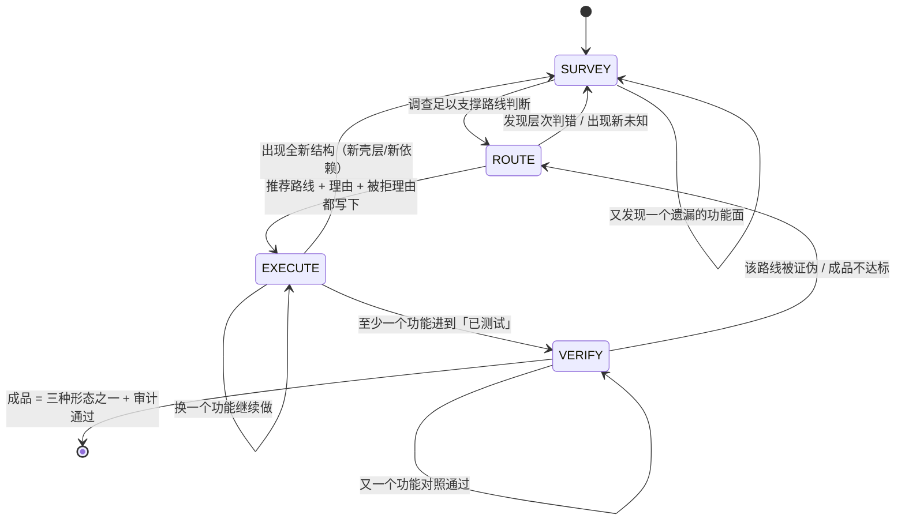

# Assault Entry —— 受保护目标攻坚的入口分流器

> **这是什么**：拿到任意一个「受保护目标」时的**第一块指示牌**。它不是步骤一，是**分流器**——
> 只回答四个问题（Q0–Q3），把你送到正确的工序卡门口。
>
> **不是什么**：不是任务清单、不是流程表、不规定动作顺序。走到哪张工序卡之后，
> 该卡自己的内容说话；执行中用四状态机（SURVEY/ROUTE/EXECUTE/VERIFY，见下）驱动滚动报告。
>
> **适用边界（先看 Q0）**：本项目（攻坚交付闭环）只对「受保护目标攻坚」这一类任务生效。
> 日常开发 / 维护 / 写代码 / 修 bug / 部署 / 写文档 —— 走既有路由与技能，**本卡到此为止**。

---

## Q0 · 这是哪类任务？

**先把任务归到三类之一，再往下走。归错类 = 后面全白做。**

| 类 | 判据（看任务本身，不看目标文件） | 去向 |
|---|---|---|
| **A. 正常开发 / 维护** | 代码是我方写的，或任务是：写新功能 / 修 bug / 重构 / 部署 / 写文档 / 写脚本 / 加参数 / 做工具 | **走既有路由与技能，本卡一行不必再读** |
| **B. 逆向 / 破解 / 分析** | 目标是**不是我方写的**程序：PE/ELF/APK/IPA/.NET/固件/JS/Web 客户端；任务含：分析、破解、脱壳、绕过、提取、复刻、patch | 进 Q1–Q3 |
| **C. 已拿到源码** | 源码在手，任务是读懂 / 改它 / 复刻它 | 走 `code-audit` / 复刻路径（`docs/DELIVERY-GOAL-2026-10-12.md`） |

**Q0=A 时到此结束。** 不建 assault.md、不填 layers、不进任何工序。
（kernel `04-全能工程中枢` 已管六条线：`desktop-product` / `web-service` / `cli-tool` /
`source-takeover` / `exe-rebuild` / `protocol-automation`；本卡不重写、不替代它们。）

**Q0=B 时的第一件事**：把「任务」翻译成「目标 + 期望成品」，然后进 Q1。

---

## Q1 · 这是什么类型的目标？

| 目标形态 | 首查手段（本机已有） | 后续工序入口 |
|---|---|---|
| Windows PE (exe/dll/sys) | `diec -d -e -j`、`file`、r2 `iI/iS/ii/iz` | `code-patching.md` / `unpack-and-memory-dump.md` / 视保护层再分流 |
| Linux ELF | `file`、r2 `iI/iS`、`lief` | 同上；动态用 `qiling` / `LD_PRELOAD` / `strace` |
| APK / Android | `apktool`、`jadx`、`apk-reverse-index.md` | `apk-reverse/`（native 切 .so 分支） |
| 固件 / IoT | `binwalk`、`file`、熵扫描 | `platforms.md` 固件节 / `firmware-pentest`（OWASP FSTM） |
| .NET / 托管 PE | `ilspycmd`、`dnSpy.Console`、`de4dot` | `dotnet-reverse/` |
| JS / Electron / Web 客户端 | `asar` 提取、`jsc`/`node`、CDP | `js-reverse/` / `web-protocol-reverse/` |
| WASM | `wasm2wat`、WABT、r2 | `languages.md` WASM 节 |
| 自定义 VM / 字节码 | `diec` 报 VM 保护、反编译呈 dispatch loop | **L1 壳层**：`vmp-virtualization-analysis.md` |

**这一步的产物**：一句话「目标格式 + 架构 + 版本」，写进报告 `## target`。

---

## Q2 · 它套了几层保护？（L0–L4 分层判定）

**判定顺序（判据，不是步骤）**：L0 容器 → L1 壳 → L2 混淆 → L3 自检 → L4 业务。
任何时刻都要能说清目标在哪几层；每层的状态与证据进报告 `## layers`。

### 每层是什么

| 层 | 保护类型 | 典型形态 |
|---|---|---|
| L0 | 容器层 | 安装包（NSIS/Inno）、ASAR、固件镜像、双体 PE（dropper+payload） |
| L1 | 壳层 | 加壳 / 压缩 / 加密载荷 / 指令虚拟化（VMP/Themida/Enigma/自定义 VM） |
| L2 | 混淆层 | OLLVM、虚假控制流、MBA、字符串加密、nanomite |
| L3 | 自检层 | 反调试 / 反 VM / 反注入 / 完整性校验 / 时间检测 |
| L4 | 业务层 | 授权 / 算法 / 协议 / 文件格式 / 网络 / 云端验证 |

### 每层的过层判据（外部可观测，不用形容词）

| 层 | 过层判据 |
|---|---|
| L0 | 拿到目标架构真实可执行体（`file` 符合预期、能加载进 r2/Ghidra） |
| L1 | IAT 从个位数涨到几十上百条；`.text` 熵从 >7.2 降到 <6.5；`iS` 无 rwx 节 |
| L2 | 反编译出可读控制流（不再是星形跳转）；布尔表达式可化简 |
| L3 | ScyllaHide 实测 peb/crdp/dbgport 三项归零；程序正常运行超 10s |
| L4 | 关键函数反编译可读；算法/协议/格式能说出输入输出契约 |

### 混合目标的常见组合

- **VMP + 云端授权**：L1（虚拟化）+ L4（云端）→ 先过 L1 拿到真实代码，再按 L4 分流；
  云端路线见 `license-keygen-06`（hook / 状态伪造，keygen 不可行）。
- **Themida + 自检**：L1（壳）+ L3（自检）→ **先过 L3**（`anti-debug-bypass.md` + ScyllaHide
  专项段），否则附加即闪退，根本走不到 dump。
- **加固 APK**：L1（packer，`apktool` 解不开）→ `apk-reverse/references/packer/` 链
  （`vmp-dex2c-detection.md` → 确认形态后再 `vmp-dump-trace-recovery.md`）。

### ★ 搬运工还是货物（在 L1 里做的每一处修改都要问）

> **你改的是运输层（壳/解密循环）还是被运输的业务代码？**
> 判定点几乎从不在 L1。**停在壳层打转 = 项目没推进。**
> 过 L1 的唯一意义是拿到可分析的货物（真实代码/数据），拿到就该往下走。

（源自 `license-keygen/README.md` 与 `re-agent-workflow.md` §2.1。）

---

## Q3 · 用户要的成品是哪种？

**成品只有三种形态，不许发明第四种：**

1. **源码 / 可构建项目**
2. **可运行的复刻实现**
3. **打了补丁的原程序**

（附注：验证态也算「成品已达成」的另一种呈现——可用绕过态 = 补丁的一种形态。）

**这一步的产物**：报告 `## target` 的 `deliverable` 一行，
形态、落点、跑起来的最小命令。**不许写形容词**（「可用」「修复」不算，要写文件路径 + 形态）。

---

## Q4 · L4 业务层分流（到了 L4 再用）

| 业务类型 | 去哪个工序卡 |
|---|---|
| 本地算法校验（key/序列号在客户端算） | `license-keygen/license-keygen-03-key-algorithm-recovery.md` |
| 签名链（RSA/Ed25519/PGP 签名验证） | `license-keygen-04-signature-chain-pubkey-swap.md` |
| 自引用（签名嵌自身/迭代收敛） | `license-keygen-07-self-ref-convergence.md` |
| 云端校验（断网即失败） | `license-keygen-06-cloud-license-hook.md` |
| 网络协议还原 | `protocol-reverse` / `web-protocol-reverse` |
| 文件格式 / 结构恢复 | `struct-reconstruction.md` / `reclass-reconstruction.md` |
| PRNG / 随机数预测 | `prng-cracking.md`（与 `prng-caching`） |
| 加密算法识别 | `crypto-algorithm-identification.md` |
| 校验链验证闭环 | `license-keygen-05-keygen-verification-loop.md` |

**分类先行**：`license-keygen/README.md` 的判定树（断网实验 2 分钟：仍能激活 → 本地 A/B/C；
失败 → D 云端）。**先分类能省掉几小时到几天**——把 D 类当 A 类硬啃是已知反模式。

---

## 状态机（SURVEY / ROUTE / EXECUTE / VERIFY）

**用法**：无顺序、无次数限制、可任意跳转。每个状态只定义三件事——
**有效动作 / 出口条件 / 必须跳走的情况**。唯一工作载体是滚动报告 `assault.md`；
报告 §0 状态行任何时刻必须能回答「现在到哪了、凭什么」。

### SURVEY（勘察）

**有效动作**：摸清这是什么、有哪几层、依赖什么、有哪些功能、哪些还不知道。
产物落在报告 `## survey` / `## layers` / `## unknowns`。

**出口条件**：九项勘察问题（格式架构版本 / 结构与节区 / 字符串常量 / 能力特征 /
反调试面 / 跑不跑得起来 / 外部依赖 / 功能清单 / 主动遗漏检查）都有答案；
`## unknowns` 每项写明「影响什么、试过什么、下一步、是否阻塞」。

**必须跳走的情况**：高层判定反复被推翻（判错层次）→ 留在 SURVEY 重判，别硬往下推。

### ROUTE（路线判断）

**有效动作**：比较五条候选路线（patch / recover / rewrite / keep / blocked），给出推荐
**和理由**，同时写下其他路线为什么不优先（`## routes` 表）。L4 业务层按
`license-keygen/README.md` 的分类**先分流再进工序**。

**出口条件**：`routes` 表每行有「证据 / 为什么不选」，`recommended` 有理由，`confidence` 已标。

**必须跳走的情况**：`confidence: low` → 不许进 EXECUTE，回 SURVEY 补证据，
或先做一个小范围验证（高风险假设优先验证）。

**反模式**：只跑 strings 看到疑似序列号字符串就直奔 `license-keygen-03`——
跳过分类的代价是大量时间浪费在一个不存在的本地公式上（`license-keygen/README.md` 原话）。

### EXECUTE（执行）

**有效动作**：按推荐路线推进，逐功能还原 / 打补丁 / 复刻，每完成一格回填 `## functions`。
规矩全部来自既有铁律（不是本卡新发明）：每改一层必须验一层；
等长替换 / 只改分支不覆盖函数入口 / 不 NOP 间接调用（`re-agent-workflow.md` §2.2）；
每层补丁 ≤2 轮无通过判据就收敛刹车（§2.3.5）；
时间盒（静态深挖约 15 分钟无关键路径 → 转动态；单步约 200 条指令无进展 → 回静态）；
产物先落盘并校验哈希，之后才允许清理。

**出口条件**：至少一个功能进到「已测试」，且 `diff/` 有对照运行记录。

**必须跳走的情况**：
- 该功能在该路线上连败两次 → 回 ROUTE 换路线（不许在原路线上加第三个补丁）
- 出现全新结构（新壳层 / 新依赖）→ 回 SURVEY 补 `## layers`

### VERIFY（验证）

**有效动作**：同输入驱动原程序与新实现，逐项比；不达标的回 ROUTE。
驱动与记录复用 `skills/scripts/diff-runner.py`，草稿落 `diff/<F-ID>.md`。

**验收判据（外部可观测）**：
- `## diff_baseline` 表逐行有「原程序结果 / 新实现结果 / 是否一致 / 说明」
- 非确定项（时间 / 随机数）先标 `NONDETERMINISTIC`，由人定容差——不许为通过而放宽标准
- `review_case.py --verify-hashes --strict` PASS

**出口条件（= 项目完成）**：`deliverable` 指向的产物**真实存在于磁盘**、可运行或可构建，
且全部功能行处于「对照一致」或「受限 + 具体原因」。

**必须跳走的情况**：任何一行对照不通过 → 回 ROUTE 或 EXECUTE；**不许把不通过改成通过**。

---

## 走完四问之后

进四状态机（SURVEY / ROUTE / EXECUTE / VERIFY）——定义见本文件 §状态机。
唯一工作载体是滚动报告 `assault.md`（`case-init -Preset assault` 生成）。

**每一步动手前问一句：「这一步是否让成品更近？」答不上来就是白做。**
