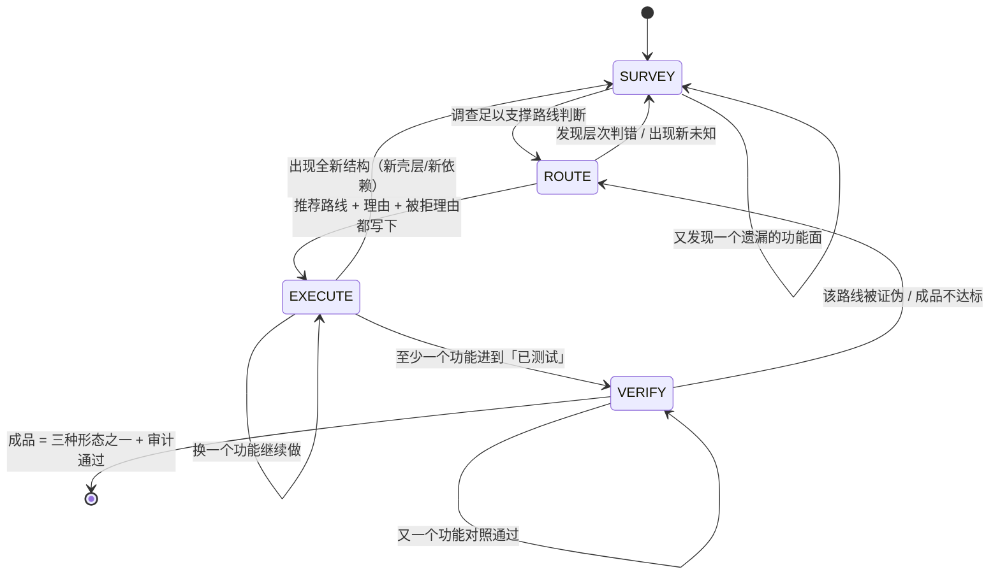

# Assault Entry —— 受保护目标攻坚的入口分流器

> **这是什么**：拿到任意一个「受保护目标」时的**第一块指示牌**。它不是步骤一，是**分流器**——
> 只回答四个问题（Q0–Q3），把你送到正确的工序卡门口。
>
> **不是什么**：不是任务清单、不是流程表、不规定动作顺序。走到哪张工序卡之后，
> 该卡自己的内容说话；执行中用四状态机（SURVEY/ROUTE/EXECUTE/VERIFY，见下）驱动滚动报告。
>
> **适用边界（先看 Q0）**：本项目（攻坚交付闭环）只对「受保护目标攻坚」这一类任务生效。
> 日常开发 / 维护 / 写代码 / 修 bug / 部署 / 写文档 —— 走既有路由与技能，**本卡到此为止**。
>
> **★ 产物落哪（先说死，免得混乱）**：技能包（`C:\relab2\skillpack`）是**工具箱本身**，
> 不是任何项目的工作区。**所有为某个目标产生的文件——报告、补丁、证据、dump、脚本——
> 一律落在「调用者当前所在的项目目录」下，不进技能包、也不回写 `relab2`。**
> - 攻坚：`<当前项目>/work/<case名>/`（`case-init` 默认就落这里，case 名以目标命名）。
> - 路由：`<当前项目>/work/route/latest/route-scope.md`（旧版归档到 `route/<sha12>/`）。
> - 换句话说：**在谁的目录里开打，产物就在谁那**。技能包只是被调用的命令，不存产物。
> - 所以以后换个项目开发，它的文档/临时文件都在**它自己的目录**下，不会堆回 relab2。

---

## ★ 攻坚者五条（动手前先读这五条，它比下面所有判据表都重要）

**这五条不是判据表，是姿态。** 判据表决定系统完不完备，这五条决定人行不行。
硬目标一定超出任何判据表的覆盖——超出之后，靠的就是这五条。

**① 分清搬运工和货物**
在壳层（L1）里花的每一分钟，都要问一句「我改的是搬运工还是货物」。
壳是搬运工，业务逻辑才是货物。判定点几乎从不在 L1。
**停在壳层打转 = 项目没推进，无论做了多少工作。**

**② 工具输出是线索，不是结论**
`diec` 报的壳类型、反编译出的伪码、`strings` 抓到的常量、`capa` 命中的能力——
**全部是线索，没有一个是事实**。反编译器会把 `__ftol()` 当返回值而藏起真实输入
（这是 REA 的 DX-Ball 案例实证）；VMP 静态看到的立即数是 VM key 加密过的假值。
**结论必须由两条以上独立证据交叉支撑**（项目里已有这规矩：ADF-R4*，validated 需 ≥2 独立证据）。

**③ 优先查矛盾，不优先查顺利**
顺利的地方最不用看。真正值钱的是「不对劲」：反编译结果和行为对不上、
导入表干净得可疑、两份证据互相冲突、函数名叫 A 但干的事像 B、静态与动态结论相反。
**矛盾就是入口。** 遇到矛盾不许选一个顺眼的放下，要查清为什么不一致。

**④ 宁可写卡住，不许写完成**
「我卡在 U-007，原因是 VM context 进出被 XOR 变换，静态拿不到布局」是**有效交付**。
「已完成」但没有对照证据是**无效交付**。
门禁绿、程序能启动、代码写完了、报告很厚——**这四件事单独一件都不等于成品**。

**⑤ 调整路线是正常的，不调整才不正常**
真打硬目标，第一次选的路线大概率不完整。一边打一边修正是人的工作方式，
也是 AI 该有的方式。调整不是失败，是进展——但每次必须写清
「旧路线为什么不通 / 新证据是什么 / 新路线凭什么更可能通」，
记进 timeline 的 `decision_delta`。**一次都没调整过的攻坚记录，默认是编的。**

**五条的根源**：终点只有一个——可运行、可验证、功能等价的成品。
每一步动手前问「这一步是否让成品更近」，答不上来就是白做。
**难度花在 `how` 上，永远不花在 `whether` 上。**

---

## ★ 第一视觉焦点 —— 先看「自检层」再看别的

> **目标跑不起来 / 调试器一挂就退 / 断点被清 / 单步像卡死** —— 第一反应不是「换个调试器再试」，
> 而是**它检测到了什么**。裸 attach 第三次之前，先把自检层过掉。
> （2026-10-13 实弹：attach 即崩被当成「payload 有问题」，查了半天，根因在自检层。）

第一眼看三样（谁先有信号看谁，没有顺序要求；三样都做，成本各 1 分钟）：

| 看什么 | 怎么看出来 | 去向 |
|---|---|---|
| **壳/虚拟化** | `diec -d -e -j` 报 VMP/Themida/Enigma；入口只有 `jmp` 跳板；函数计数异常低；节区高熵 | `vmp-virtualization-analysis.md` / `unpack-and-memory-dump.md`；**先判形态再动手**，别在壳层改字节 |
| **自检（反调试）** | attach 即退/秒退、`IsDebuggerPresent`/`CheckRemoteDebuggerPresent` 命中、单步异常、时间差测量、父进程名校验 | `anti-debug-bypass.md`（自检表 §1 + ScyllaHide 专项）；过层判据：peb/crdp/dbgport 三项归零 + 程序运行 >10s |
| **工具通道** | **动手前先跑一次** `powershell -NoProfile -ExecutionPolicy Bypass -File <技能包根>\skills\scripts\mcp-status.ps1`（1 秒）：三列「谁注册 / 谁在 LISTEN / 怎么起」；要用的 IDA(x64dbg/Ghidra) 通道如果 `closed`，照它给的命令自己起，起完重跑确认 `LISTEN` 再 attach。**注册 ≠ 在监听；冷启是设计不是故障** | 端点事实源 `references/tool-registry.md`；不许假装看不见工具，也不许让用户手改 `mcp.json` |

**时间盒（换法阈值）**：静态判壳/找 OEP **约 2 分钟**无关键结论 → 转动态；
动态 attach **两次**被自检打掉 → 停手，回自检层按 `anti-debug-bypass.md` 一条条过；
过完自检层再 attach，**不做第三次裸 attach**（第三次只是把同一个坑再踩一遍）。

---

## ★ 主人可见性 —— 只报关键点，用人话（与五条并列）

**主人是零基础，看不懂技术报告。** 他不是要你每步都报——报多了只是噪音，他更懵。
但**在长任务里闷头钻技术、卡住了也不回头说话**，是已经被坑过一次的事（2026-10-13
实弹卡死、主人等了一夜不知道发生了什么）。所以定死一条规矩：

**① 不要每步都报。** 工具调用、逐层进展、微调、换断点——都不用报。

**② 只在四个关键点报**（不多不少）：
- 定完路线、准备开打
- **卡住了 / 要停下**（含报错、判定受阻）
- 成品出来了
- 需要主人给东西或做决定

**③ 报就四句话，全大白话**（不许术语、不许清单、不许堆文件路径）：
1. 现在到哪了
2. 成品到没到（到了 = 什么样子；没到 = 还差哪一步）
3. 要不要主人给东西（要的话具体要啥）
4. 下一步干什么

**④ 落地**：
- 报告 `assault.md` 的 §0 状态行，任何时刻保持这四句是最新的（**这就是「在磁盘上、
  不在上下文里」**——上下文会被压缩、会话会中断，磁盘不会）。
- 长任务每次停下（完成 / 卡住 / 报错），在聊天里贴一次这四句。
- 主人回来只看这四句，就能决定：继续 / 补东西 / 收工。

**这条和五条一样是姿态，不是判据表**：五条管「自己别骗自己」，这条管「别让主人懵」。

---

## Q0 · 这是哪类任务？

**先把任务归到三类之一，再往下走。归错类 = 后面全白做。**

| 类 | 判据（看任务本身，不看目标文件） | 去向 |
|---|---|---|
| **A. 正常开发 / 维护** | 代码是我方写的，或任务是：写新功能 / 修 bug / 重构 / 部署 / 写文档 / 写脚本 / 加参数 / 做工具 | **走既有路由与技能，本卡一行不必再读** |
| **B. 逆向 / 破解 / 分析** | 目标是**不是我方写的**程序：PE/ELF/APK/IPA/.NET/固件/JS/Web 客户端；任务含：分析、破解、脱壳、绕过、提取、复刻、patch | 进 Q1–Q3 |
| **C. 已拿到源码** | 源码在手，任务是读懂 / 改它 / 复刻它 | 走 `code-audit` / 复刻路径（`docs/DELIVERY-GOAL-2026-10-12.md`） |

**主人是零基础，他不会说术语——「说一句人话」也必须能命中。** 人话对照表：

| 主人可能说的（人话） | 判去哪 | 谁的地盘 |
|---|---|---|
| 「帮我做个 XX 软件 / 小工具 / 网站」 | 有窗口 → `desktop-product`；网站/后端 → `web-service`；命令行 → `cli-tool` | kernel（只读引用） |
| 「这个项目别人写的，我接手继续改」 | `source-takeover` | kernel（只读引用） |
| 「这个 exe 没源码，我要二开 / 改成自己的卖」 | `exe-rebuild` | kernel（只读引用） |
| 「帮我采集 / 自动化 / 抓协议 / 研究 App 业务流程」 | `protocol-automation` | kernel（只读引用） |
| 「这个程序你帮我分析 / 破解 / 脱壳 / 复刻」 | **本卡**：Q1–Q3 → 四状态机 | skillpack（本项目） |
| 「给脚本加个参数」「修个 bug」（一句话小修） | 既有路由与技能，**零额外工序** | 原样，不建案、不进本卡 |

（前四行是 kernel 六条业务线的主场：入口 `kernel/03-bundle/dist/hubcore/CORE.md`（选线），
选定后读同目录 `workflows/<线名>.md`
（`desktop-product` / `web-service` / `cli-tool` / `source-takeover` / `exe-rebuild` /
`protocol-automation`）。**本卡只指路，不重写、不替代它们。**）

**Q0=A 时到此结束。** 不建 assault.md、不填 layers、不进任何工序。

**Q0=B 时的第一件事**：把「任务」翻译成「目标 + 期望成品」，然后进 Q1。

---

## Q1 · 这是什么类型的目标？

| 目标形态 | 首查手段（本机已有） | 后续工序入口 |
|---|---|---|
| Windows PE (exe/dll/sys) | `diec -d -e -j`、`file`、r2 `iI/iS/ii/iz` | `code-patching.md` / `unpack-and-memory-dump.md` / 视保护层再分流 |
| Linux ELF | `file`、r2 `iI/iS`、`lief` | 同上；动态用 `qiling` / `LD_PRELOAD` / `strace` |
| APK / Android | `apktool`、`jadx`、`apk-reverse-index.md` | `apk-reverse/`（native 切 .so 分支） |
| 固件 / IoT | `binwalk`、`file`、熵扫描 | `platforms.md` 固件节 / `firmware-pentest`（OWASP FSTM） |
| .NET / 托管 PE | `ilspycmd`、`dnSpy.Console`、`de4dot` | `dotnet-reverse/` |
| JS / Electron / Web 客户端 | `asar` 提取、`jsc`/`node`、CDP | `js-reverse/` / `web-protocol-reverse/` |
| WASM | `wasm2wat`、WABT、r2 | `languages.md` WASM 节 |
| 自定义 VM / 字节码 | `diec` 报 VM 保护、反编译呈 dispatch loop | **L1 壳层**：`vmp-virtualization-analysis.md` |

**这一步的产物**：一句话「目标格式 + 架构 + 版本」，写进报告 `## target`。

---

## Q2 · 它套了几层保护？（L0–L4 分层判定）

**判定顺序（判据，不是步骤）**：L0 容器 → L1 壳 → L2 混淆 → L3 自检 → L4 业务。
任何时刻都要能说清目标在哪几层；每层的状态与证据进报告 `## layers`。

### 每层是什么

| 层 | 保护类型 | 典型形态 |
|---|---|---|
| L0 | 容器层 | 安装包（NSIS/Inno）、ASAR、固件镜像、双体 PE（dropper+payload） |
| L1 | 壳层 | 加壳 / 压缩 / 加密载荷 / 指令虚拟化（VMP/Themida/Enigma/自定义 VM） |
| L2 | 混淆层 | OLLVM、虚假控制流、MBA、字符串加密、nanomite |
| L3 | 自检层 | 反调试 / 反 VM / 反注入 / 完整性校验 / 时间检测 |
| L4 | 业务层 | 授权 / 算法 / 协议 / 文件格式 / 网络 / 云端验证 |

### 每层的过层判据（外部可观测，不用形容词）

| 层 | 过层判据 |
|---|---|
| L0 | 拿到目标架构真实可执行体（`file` 符合预期、能加载进 r2/Ghidra） |
| L1 | IAT 从个位数涨到几十上百条；`.text` 熵从 >7.2 降到 <6.5；`iS` 无 rwx 节 |
| L2 | 反编译出可读控制流（不再是星形跳转）；布尔表达式可化简 |
| L3 | ScyllaHide 实测 peb/crdp/dbgport 三项归零；程序正常运行超 10s |
| L4 | 关键函数反编译可读；算法/协议/格式能说出输入输出契约 |

### 混合目标的常见组合

- **VMP + 云端授权**：L1（虚拟化）+ L4（云端）→ 先过 L1 拿到真实代码，再按 L4 分流；
  云端路线见 `license-keygen-06`（hook / 状态伪造，keygen 不可行）。
- **Themida + 自检**：L1（壳）+ L3（自检）→ **先过 L3**（`anti-debug-bypass.md` + ScyllaHide
  专项段），否则附加即闪退，根本走不到 dump。
- **加固 APK**：L1（packer，`apktool` 解不开）→ `apk-reverse/references/packer/` 链
  （`vmp-dex2c-detection.md` → 确认形态后再 `vmp-dump-trace-recovery.md`）。

### ★ 搬运工还是货物（在 L1 里做的每一处修改都要问）

> **你改的是运输层（壳/解密循环）还是被运输的业务代码？**
> 判定点几乎从不在 L1。**停在壳层打转 = 项目没推进。**
> 过 L1 的唯一意义是拿到可分析的货物（真实代码/数据），拿到就该往下走。

（源自 `license-keygen/README.md` 与 `re-agent-workflow.md` §2.1。）

---

## Q3 · 用户要的成品是哪种？

**成品只有三种形态，不许发明第四种：**

1. **源码 / 可构建项目**
2. **可运行的复刻实现**
3. **打了补丁的原程序**

（附注：验证态也算「成品已达成」的另一种呈现——可用绕过态 = 补丁的一种形态。）

**这一步的产物**：报告 `## target` 的 `deliverable` 一行，
形态、落点、跑起来的最小命令。**不许写形容词**（「可用」「修复」不算，要写文件路径 + 形态）。

---

## ★ 宿主 / 环境依赖 —— 在 ROUTE 之前必须先判

> 有些目标的「功能」**只相对于另一个活着的进程 / 服务 / 设备存在**：游戏外挂要真实游戏
> （进程名 + 读它的内存）、插件要宿主宿主、云端授权要真服务器、驱动要真硬件。
> **不先判这一条，就会在「成品定义」上反复纠结，或在错误的假设上浪费时间。**
> （2026-10-13 实弹：`测试exe.exe` 卡在 payload 崩，而「payload 是否需要真实游戏内存」
> 一度建立在被污染的日志上——这就是没先判依赖的代价。）

**三档，必须落进报告 `## target` 的 `host_dependency` 一行：**

| 档 | 判据（外部可观测） | 对成品的影响 |
|---|---|---|
| **无依赖** | 静态无网络导入、无进程/设备查询；断网 + 无宿主下功能正常 | 成品可独立验收（默认口径） |
| **可模拟依赖** | 目标只查「宿主存在/名字/路径」（低成本字符串比较），**不读宿主内部数据** | 用 stub 进程/假服务即可喂饱 → **仍按独立成品验收** |
| **硬依赖** | 目标**读宿主的内存 / 调宿主的私有接口 / 要真实数据** | 无真实宿主时**功能不可能正常**；需主人决策验收口径 |

**怎么判（动手前，2 分钟内能做）**：
1. 静态看它查宿主时**只比对名字/路径**，还是**拿去 `OpenProcess`+`ReadProcessMemory` / RPC / 句柄**。
   （本机实测：`测试exe.exe` 的 check2 = `QueryFullProcessImageNameW` → 只拿路径 = **可模拟档**。）
2. 动态喂假宿主：造一个同名 stub（`fake_riot.c` 那种），看目标行为是**继续推进**还是**仍在别处崩**。
3. 若崩在「读宿主数据」处 → 硬依赖；若只是「查存在性」→ 可模拟档，**别过早下「必须真游戏」的结论**。

★ **这一条与成品定义（U-006 那类问题）的关系**：只有判出「硬依赖」，才需要主人拍验收口径；
判成「可模拟」的目标，**不许拿「依赖外部」当借口少做**。

---

## Q4 · L4 业务层分流（到了 L4 再用）

| 业务类型 | 去哪个工序卡 |
|---|---|
| 本地算法校验（key/序列号在客户端算） | `license-keygen/license-keygen-03-key-algorithm-recovery.md` |
| 签名链（RSA/Ed25519/PGP 签名验证） | `license-keygen-04-signature-chain-pubkey-swap.md` |
| 自引用（签名嵌自身/迭代收敛） | `license-keygen-07-self-ref-convergence.md` |
| 云端校验（断网即失败） | `license-keygen-06-cloud-license-hook.md` |
| 网络协议还原 | `protocol-reverse` / `web-protocol-reverse` |
| 文件格式 / 结构恢复 | `struct-reconstruction.md` / `reclass-reconstruction.md` |
| PRNG / 随机数预测 | `prng-cracking.md`（与 `prng-caching`） |
| 加密算法识别 | `crypto-algorithm-identification.md` |
| 校验链验证闭环 | `license-keygen-05-keygen-verification-loop.md` |

**分类先行**：`license-keygen/README.md` 的判定树（断网实验 2 分钟：仍能激活 → 本地 A/B/C；
失败 → D 云端）。**先分类能省掉几小时到几天**——把 D 类当 A 类硬啃是已知反模式。

---

## 状态机（SURVEY / ROUTE / EXECUTE / VERIFY）

**用法**：无顺序、无次数限制、可任意跳转。每个状态只定义三件事——
**有效动作 / 出口条件 / 必须跳走的情况**。唯一工作载体是滚动报告 `assault.md`；
报告 §0 状态行任何时刻必须能回答「现在到哪了、凭什么」。

### SURVEY（勘察）

**有效动作**：摸清这是什么、有哪几层、依赖什么、有哪些功能、哪些还不知道。
产物落在报告 `## survey` / `## layers` / `## unknowns`。

**出口条件**：十项勘察问题（格式架构版本 / 结构与节区 / 字符串常量 / 能力特征 /
反调试面 / 跑不跑得起来 / 外部依赖 / 功能清单 / **工具通道状态**（`mcp-status.ps1` 三列：谁注册、谁在 LISTEN、怎么起；要用的通道起没起） / 主动遗漏检查）都有答案；
`## unknowns` 每项写明「影响什么、试过什么、下一步、是否阻塞」。

**必须跳走的情况**：高层判定反复被推翻（判错层次）→ 留在 SURVEY 重判，别硬往下推。

### ROUTE（路线判断）

**有效动作**：比较五条候选路线（patch / recover / rewrite / keep / blocked），给出推荐
**和理由**，同时写下其他路线为什么不优先（`## routes` 表）。L4 业务层按
`license-keygen/README.md` 的分类**先分流再进工序**。

**出口条件**：`routes` 表每行有「证据 / 为什么不选」，`recommended` 有理由，`confidence` 已标。

**必须跳走的情况**：`confidence: low` → 不许进 EXECUTE，回 SURVEY 补证据，
或先做一个小范围验证（高风险假设优先验证）。

**反模式**：只跑 strings 看到疑似序列号字符串就直奔 `license-keygen-03`——
跳过分类的代价是大量时间浪费在一个不存在的本地公式上（`license-keygen/README.md` 原话）。

### EXECUTE（执行）

**有效动作**：按推荐路线推进，逐功能还原 / 打补丁 / 复刻，每完成一格回填 `## functions`。
规矩全部来自既有铁律（不是本卡新发明）：每改一层必须验一层；
等长替换 / 只改分支不覆盖函数入口 / 不 NOP 间接调用（`re-agent-workflow.md` §2.2）；
每层补丁 ≤2 轮无通过判据就收敛刹车（§2.3.5）；
时间盒（静态深挖约 15 分钟无关键路径 → 转动态；单步约 200 条指令无进展 → 回静态）；
产物先落盘并校验哈希，之后才允许清理。

**出口条件**：至少一个功能进到「已测试」，且 `diff/` 有对照运行记录。

### ★★ 入档关口：什么才能进 `## functions` / `## diff_baseline`

**关键结论（"某地址已进入""控制流已到达""对象已释放""某函数是谁"这类）在写进 `## functions` /
`## diff_baseline` / 任何"已完成"栏之前，必须过这道关，否则只许进 `## unknowns`：**

1. **≥2 条独立证据**：结论由**两条相互独立**的证据交叉支撑（不是同一次运行的两个读数）。
2. **动态判据多轮**：涉及运行时（断点 / hook / 内存读）的，按 `anti-debug-bypass.md` §8 硬约束
   跑 **≥3 轮**、用**原子 `@rip`**；单轮不算数。
3. **写清"证据是什么"**：入档时那一格必须能回答"凭哪两条证据、跑了几轮"。
4. **未达标 → 只进 `## unknowns`**，并写明"待验证"；**不许**先当"已完成/已进入"写进 functions/diff。

> **为什么是关口**：2026-10-13 实弹里，**假结论（污染日志当命中）先写进 FEATURES/assault/§9c、
> 跑绿门禁、commit，并宣称"全部完成"**，随后才被推翻、全套文档重写。
> `assault.md` 允许"越改越准"，但**"越改越准"不等于"可以先写假结论"**——入档前先过关。

**必须跳走的情况**：
- 该功能在该路线上连败两次 → 回 ROUTE 换路线（不许在原路线上加第三个补丁）
- 出现全新结构（新壳层 / 新依赖）→ 回 SURVEY 补 `## layers`
- **关键结论未过入档关口** → 移进 `## unknowns`，别留在 functions/diff

### VERIFY（验证）

**有效动作**：同输入驱动原程序与新实现，逐项比；不达标的回 ROUTE。
驱动与记录复用 `skills/scripts/diff-runner.py`，草稿落 `diff/<F-ID>.md`。

**验收判据（外部可观测）**：
- `## diff_baseline` 表逐行有「原程序结果 / 新实现结果 / 是否一致 / 说明」
- 非确定项（时间 / 随机数）先标 `NONDETERMINISTIC`，由人定容差——不许为通过而放宽标准
- `review_case.py --verify-hashes --strict` PASS

**出口条件（= 项目完成）**：`deliverable` 指向的产物**真实存在于磁盘**、可运行或可构建，
且全部功能行处于「对照一致」或「受限 + 具体原因」。

**必须跳走的情况**：任何一行对照不通过 → 回 ROUTE 或 EXECUTE；**不许把不通过改成通过**。

---

## 走完四问之后

进四状态机（SURVEY / ROUTE / EXECUTE / VERIFY）——定义见本文件 §状态机。
唯一工作载体是滚动报告 `assault.md`（`case-init -Preset assault` 生成）。

**每一步动手前问一句：「这一步是否让成品更近？」答不上来就是白做。**
