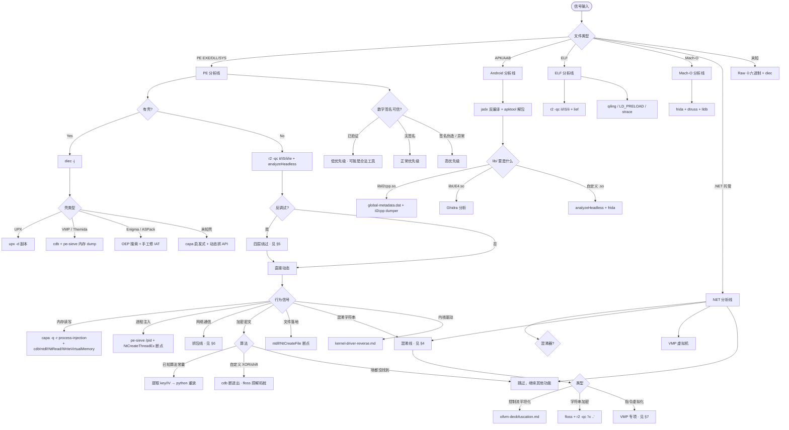

# 按信号选工具决策树

> **来源**：改编自 `LING71671/open-reverselab` 的 `kb/general/techniques/methodology/02-toolchain-decision-tree.md`（GPL-3.0），工具全部换成探测层 id + 本机实测命令。
> **什么时候用**：**已经观察到具体信号**（文件类型、壳、反调试退出、加密数据流、网络调用），需要立刻知道「下一步用哪把刀」。
> **和谁互补**：本篇是**分析期**的信号路由；`../../MASTER-ROUTING.md` 是**任务接单期**的关键词路由。两者不冲突，见 §1。

---

## 适用信号

- 「我看到一个可疑进程在跑，但不知道该上什么工具」
- 「`diec` 说这是 Themida，然后呢」
- 「附加调试器它就退出 —— 现在用哪一层手段绕过」
- 「反编译出来一堆 XOR shift rotate，是不是加密，怎么下手」
- 「抓到一堆 HTTPS 流量，明文怎么拿」

不适用：

| 情况 | 去哪 |
|------|------|
| 样本刚到手，连类型都不知道 | `triage-first-30-min.md` 先跑 30 分钟 |
| 还没决定要不要深挖 | `../../ops/analysis-decision-framework.md`（ADF） |
| 只需要一份固定流程 | `re-agent-workflow.md` |

---

## 前置

```powershell
. 'C:\relab2\skillpack\skills\scripts\lib\Bootstrap.ps1'
```

本文出现的所有工具 id 都通过 `Resolve-ReverseToolSpec -Name '<id>'` 取 `$r.Command` 调用；**本文不写死路径**。

| 信号类别 | 工具 id | 实测解析到（仅 sanity check） |
|----------|---------|------|
| 查壳 / 判编译器 | `diec` | `(Resolve-ReverseToolSpec -Name 'diec').Command` |
| 静态 CLI（概览/节区/导入/字符串/搜索/反汇编） | `r2` | `(Resolve-ReverseToolSpec -Name 'r2').Command` |
| 混淆字符串 | `floss` | `D:\Tools\cli\floss.cmd` |
| 能力识别 / ATT&CK | `capa` | `(Resolve-ReverseToolSpec -Name 'capa').Command` |
| 自动脱壳 | `upx` | `(Resolve-ReverseToolSpec -Name 'upx').Command` |
| Ghidra 无头 | `analyzeHeadless` | `(Resolve-ReverseToolSpec -Name 'analyzeHeadless').Command` |
| IDA 无头 | `idat64` / `idat` | 8.3 便携版 / 9.4 |
| 动态调试（脚本化） | `cdb` / `cdbX86` | `%LOCALAPPDATA%\Microsoft\WindowsApps\cdb.exe` |
| 动态调试（交互式） | `x64dbg` + MCP | 走 `xd://mcp__x64dbg_automate_mcp_*` |
| 反反调试 L1（注入式） | `scyllahide` | `(Resolve-ReverseToolSpec -Name 'scyllahide').Command` |
| 反反调试 L3（硬件断点） | `cdb` 的 `ba` 命令 | 同上 |
| 注入 / inline hook 扫描 | `pe-sieve` | `(Resolve-ReverseToolSpec -Name 'pe-sieve').Command` |
| 规则匹配 | `yara` | `(Resolve-ReverseToolSpec -Name 'yara').Command` |
| 符号执行 / 约束 | `python` + `angr` / `z3` | `(Resolve-ReverseToolSpec -Name 'pyre').Command` |
| 仿真执行 | `python` + `qiling` / `unicorn` | 同上 |
| 补丁写入 | `python` + `lief` / `pefile` | 同上 |
| 抓包 | `tshark` / `mitmdump` | **本机未装 Npcap**（2026-10-18 复核：`wpcap.dll` 不存在、`sc query npcap` → 1060）。`tshark` 只能读已有 pcap 文件；实时抓包要先装 Npcap，或用 `mitmdump` 走 HTTP 代理 |
| Android | `jadx` / `apktool` / `adb` / `frida` / `objection` | 探测层 |
| .NET | `ilspycmd` / `de4dot` / `dnSpy.Console` / `Confuser.CLI` | 探测层 |

> ⚠ `idat`（IDA 9.3）本机**无 license 时会直接 exit 1**。需要 headless 反编译时优先 `idat64`（8.3 便携版）。

---

## 1. 两套路由的关系（先读这段，否则会用错）


| | `../../MASTER-ROUTING.md` | 本篇 |
|---|---|---|
| **时机** | 接单时，动手之前 | 分析中，已有观察结果 |
| **输入** | 用户原话 / 任务描述 | 可观测信号（diec 输出、崩不崩、抓到啥包） |
| **输出** | PRIMARY skill + 角色 | 具体工具 id + 具体命令 |
| **粒度** | 粗：谁来做 | 细：用哪把刀 |
| **谁执行** | 路由协议第 1-5 条 | 分析者自己 |

**什么时候用哪个**：

- 手上只有一句「帮我看看这个 exe」→ **MASTER-ROUTING**（先定 skill）
- 已经跑完 triage、看到 `diec` 报 `Themida` → **本篇**（定工具）
- 不确定 → 先 MASTER-ROUTING，再 triage，再本篇。顺序固定。

---

## 2. Mermaid 决策流程图



---

## 3. 文件类型决策

### 3.1 PE（Windows）—— 主战场

```text
信号: MZ header (4D 5A) + PE header (50 45 00 00)
  ↓
1. 哈希 + 类型
   [System.Security.Cryptography.SHA256]  → 样本 ID
   diec -j <file>                          → filetype / packer / compiler
  ↓
2. 结构概览
   r2 -qc 'iI' <file>   # 位数、编译时间戳、PDB、baddr
   r2 -qc 'iS' <file>   # 节区 + 权限
   r2 -qc 'ii' <file>   # 导入
   r2 -qc 'iE' <file>   # 导出（DLL/SYS 必看）
   r2 -qc 'ie' <file>   # 入口点
  ↓
3. 全量静态分析
   analyzeHeadless <proj> tmp -import <file> -deleteProject < nul
   或 idat64.exe -A -B -S<script.py> <file>   （脚本须 idc.qexit(0)）
  ↓
4. 能力识别
   capa -q -r 'anti-debug/evasion' -r 'process-injection' <file>
  ↓
5. 按 §2 流程图分支到具体工具
```

**判据**：

- `iI` 里 `bintype pe` + `bits 64` → 确认 PE64
- `iI` 里出现 `dbg_file xxx.pdb` → **PDB 可用**，下一步去符号服务器
- `iS` 里权限列出现 `rwx` 的可执行节 → 要么 .NET，要么壳，要么自修改代码

**PE 特殊类型**：

| 类型 | 特征 | 分析路径 |
|------|------|----------|
| EXE | `Characteristics` 无 `DLL` 标志 | 直接启动，`cdb -cf <plan> -o <exe>` |
| DLL | 有导出表 | `DllMain` + 导出函数优先；需要宿主进程才能跑起来 |
| SYS | 节区名 `PAGE` / 驱动签名 | `../kernel-driver-reverse.md`；需要 test-signing VM |
| .NET | `diec` 报 `Mono/.Net assembly` | `ilspycmd` 直接反编译；ConfuserEx → `de4dot` + `Confuser.CLI` |

### 3.2 APK / Android

```text
信号: ZIP header (50 4B 03 04) + lib/ 目录 + AndroidManifest.xml
  ↓
1. jadx <apk> -d <out>            # DEX → Java 伪代码
   apktool d <apk> -o <out>       # 资源 + smali
2. 看 lib/ 装载了什么
   libil2cpp.so  → Unity IL2CPP，配 global-metadata.dat
   libUE4.so     → Unreal
   *.so 自定义   → 原生，analyzeHeadless 分析
3. 加固检测
   360加固 / 腾讯乐固 / 梆梆 / Ali  → 先脱壳，脱不动走 frida dump
4. 动态
   adb + frida / objection
```

**判据**：`jadx` 输出里 `AndroidManifest.xml` 的 `package` 非空，且 `jadx` 报告的 dex 数量 > 0 → 确认是有效 APK 而非伪装。`lib/` 下 `.so` 总大小 > 20MB 且无符号（`.symtab` 缺失）→ 预期重度混淆。

### 3.3 ELF

```text
信号: ELF header (7F 45 4C 46)
  ↓
1. r2 -qc 'iI' / 'iS' / 'ii' <file>     # 结构
   python -c "import lief; ..."          # 更细的重定位/段权限
2. 静态：analyzeHeadless 或 r2
3. 动态：qiling 仿真（跨架构首选）/ LD_PRELOAD hook / strace
```

**判据**：`iI` 里 `bintype elf` + `arch` 字段给出具体架构（x86 / arm / aarch64 / mips）。`arch` 是 `arm` 且样本出现在 Android 路径下 → 走 3.2 而不是本节。

### 3.4 Mach-O

```text
信号: FE ED FA CE / CF FA ED FE / CA FE BA BE 魔数
  ↓
r2 -qc 'iI' / 'iS' / 'ii' <file>
动态：frida + dtruss（DTrace）+ lldb
iOS 设备：mobile-reverse/SKILL.md
```

**判据**：`iI` 里 `bintype mach0` + `class` 为 `MACH0_64`；`iOS` 平台还要看是否有 `LC_ENCRYPTION_INFO_64` —— 有且 `cryptid != 0` 说明是 App Store 加密，需要先 dump decrypted image。

---

## 4. Obfuscation / Packer 信号决策

### 4.1 Packer 分支

```text
信号: diec -j <file> 的 detects[].values[] 里出现 type ∈ {packer, protector}
  ↓
├─ UPX        → upx -d <副本>        （实测可一键脱：54111→41311→脱回 54111）
├─ MPRESS     → 无一键 → 动态找 OEP + 内存 dump
├─ ASPack     → 手动 ESP 定律，x86 优先（64 位不要死磕）
├─ Enigma     → OEP 搜索 + IAT 修复
├─ VMProtect  → 不能静态脱；cdb 跑到 OEP → pe-sieve dump
├─ Themida    → 同 VMP，且必带反调试 → 先走 §5 再 dump
└─ 未知/私有  → capa 启发式 + cdb 动态抓 API 列表反推
```

**判据**：

- UPX：`upx -d` 退出码 **0** 且文件变小、节区恢复成 `.text/.rdata/...` —— 退出码非 0（`NotPackedException`）说明不是真 UPX 或已二次加工
- VMP/Themida：脱壳后 `r2 -qc 'ii'` 的导入项数 **从个位数涨到几十上百条**，且 `iS` 里不再有 `rwx` 节 —— 两个同时成立才算脱干净
- 只看「脱壳不报错」不算成功：必须验证 `iI` 里的 `compiled` 时间戳变成合理值

### 4.2 Obfuscation 分支

```text
信号: Ghidra/r2 反编译出来大量 jmp/jz 跳转、无意义的栈操作
  ↓
├─ 控制流平坦化 (OLLVM fla)  → references/ollvm-deobfuscation.md
│                               obpo-plugin / d810-ng / angr deflat
├─ 虚假控制流 (bcf)          → d810-ng 不透明谓词消除；或符号执行
├─ 字符串加密                → floss <file>  ; r2 -qc '/x <sbox前16字节>' <file> 定位解密循环
├─ 调用混淆 / IAT hide       → capa -q -r 'obfuscation' 确认 → 动态抓 API
└─ 反反编译                  → 换工具（analyzeHeadless 与 idat64 交叉）或直接动态
```

**判据**：

- OLLVM：`r2 -qc 'pdf @ <可疑函数>'` 里出现**唯一的 dispatcher 块 + 大 switch**，且各 case 之间无逻辑关联 → 确认 `fla`
- 字符串加密：`floss` 的输出行数 **明显多于** `r2 -qc 'izz'` 的命中数（实测能多出成百上千行）→ 确认有栈构造/解码字符串
- 定位解密循环：`r2 -qc '/x 6367 7c77 7ef2 6b6f c516 30 51` （AES S-box 前 12 字节）在没有 `AesEncrypt` 导入的样本里命中 → 自实现 AES

---

## 5. Anti-Debug 信号决策

```text
信号: 附加调试器后样本退出 / 抛异常 / 行为改变
  ↓
先静态确认检测点
  capa -q -r 'anti-debug/evasion' <file>
  r2 -qc 'ii~IsDebuggerPresent' <file>
  r2 -qc 'ii~NtQueryInformationProcess' <file>
  r2 -qc 'ii~NtSetInformationThread' <file>
  → 判据: 输出里出现具体函数名 + 具体信息类（ProcessDebugPort / ThreadHideFromDebugger）
```

### 四层绕过（按优先级从上到下）

| 层 | 手段 | 工具 id | 做法 | 判据 |
|----|------|---------|------|------|
| **L1** | 注入式隐藏调试器 | `scyllahide` | `& $sh -p <pid>`（`InjectorCLIx64.exe`），先注入再挂 | 注入器 exit 0 + 输出 `Loaded VA`；`IsDebuggerPresent` 返回 0 |
| **L2** | 调试器内置插件 | `x64dbg` + ScyllaHide 插件 | GUI + MCP；x64 和 x32 插件都要装齐 | 调试器里 ScyllaHide 面板勾选生效，`ntdll` 的 hook 已装 |
| **L3** | 硬件断点 | `cdb` | `ba 1 eip <addr>` 走 DR0–DR3 | **不写目标内存、不落 INT3** → 完整性校验 / CRC 检测不出来 |
| **L4** | 非侵入式追踪 | ETW / Intel PT / 无侵入 dump | `pe-sieve` 外部进程扫描 | 目标进程里没落任何补丁字节 |

**优先级建议**：

1. 先 L3 试一下 —— 成本最低，且对「查调试器是否存在」这类检测完全隐形
2. L3 顶不住（比如检测的是硬件断点寄存器）→ L1 注入
3. 目标是 Themida/VMP 这类强保护 → L2 插件 + 配置档（`<scyllahide 目录>\scylla_hide.ini` 里按 `[VMProtect x64]` / `[Themida x64]` 段选）
4. 全部无效 → 走非侵入式（外部内存 dump），放弃「在它里面单步」这个想法

**L3 实测模板**：

```powershell
. 'C:\relab2\skillpack\skills\scripts\lib\Bootstrap.ps1'
$dbg = (Resolve-ReverseToolSpec -Name 'cdb').Command
$cf  = '<plan>.txt'
@(
  'bu ntdll!NtCreateFile'     # 软件断点（软件断点会写 INT3）
  'g'
  '.echo MARK'
  'q'
) -join "`r`n" | Set-Content $cf -Encoding ASCII
& $dbg -cf $cf -o <exe> *> cdb.log

# 换成硬件断点：不写目标内存
@(
  'ba 1 eip <目标函数地址>'
  'g'
  '.echo MARK'
  'q'
) -join "`r`n" | Set-Content $cf -Encoding ASCII
& $dbg -cf $cf -o <exe> *> cdb-hw.log
```

**判据**：软件断点版本会在目标模块的 `CreateFile` 导出 thunk 上看到 `int 3`（`0xCC`）被写入；硬件断点版本**看不到任何字节变化**，但 `Breakpoint 0 hit` 照样出现 —— 这就是 L3 对付 INT3 完整性校验的原理。

> 具体 cdb 坑（`-cf` 必需、断点顺序、`da` vs `du`、日志 UTF-16、`bl` 显示≠命中）见 `triage-first-30-min.md` §6.1，本篇不重复。

---

## 6. Crypto / Network 信号决策

### 6.1 已知算法

```text
信号: 反编译里有 AES S-box / CRC32 表 / 固定魔术数
  ↓
python -c "import r2pipe"  之类不靠谱 —— 直接用 r2 搜字节：
  r2 -qc '/x 6367 7c77 7ef2 6b6f c516 3051' <file>    # AES S-box
  r2 -qc '/x 0123456789' ...                            # 太短，换更长的
  capa -q -r 'data-encryption' <file>
  ↓
提取四要素:
  ├─ 算法类型（AES-256-CBC / RSA-2048 / HMAC-SHA256 / 自定义）
  ├─ Key / IV 的位置（硬编码常量 / 运行时派生 / 协商得到）
  ├─ 被加密的数据位置（自身 .data / 网络包 / 配置文件）
  └─ 输出: 独立 python 脚本，用样本里的一段已知明文/密文对账
```

**魔术数速查**：

| 算法 | 常量 |
|------|------|
| MD5 init | `0x67452301` |
| SHA-256 init | `0x6a09e667` / `0xbb67ae85` |
| CRC32 表首项 | `0x77073096` |
| AES S-box 首 12 字节 | `63 67 7c 77 7e f2 6b 6f c5 16 30 51` |
| RC4 / XOR 流 | 无常量，看循环结构 |

**判据**：提取完成后，**必须用样本自身的一段数据跑通 python 重放**，输出与样本输出一致才算数。提取到「疑似 key」不算数。

### 6.2 自定义算法

```text
信号: 没有任何已知常量，但有密集 XOR / shift / rotate 循环
  ↓
1. floss <file>                        # 捞编码字符串和解密桩
2. r2 -qc 'pdf @ <可疑函数>' <file>    # 读循环体，找轮数/密钥长度
3. cdb 断在函数入口和返回处，前后 dump 缓冲区
4. python 重放 + 逐字节 diff 验证
```

**判据**：同一函数连断两次，两次抓到的**明文不同、密文不同，但两者 XOR 出来是同一个常量** → 单字节/重复字节 XOR 流密码，key 已锁定。这个「两次抓取 XOR 对账」是最快的确认手段。

### 6.3 网络

```text
信号: r2 -qc 'ii' 里有 WSAStartup / InternetOpen / WinHttpOpen
  ↓
r2 -qc 'ii~WS2'      <file>     # Winsock
r2 -qc 'ii~winhttp'  <file>     # WinHTTP
r2 -qc 'ii~wininet'  <file>     # WinINet
  ↓
分支:
  ├─ HTTP 明文        → tshark -r <cap> -Y http -T fields -e http.host -e http.request.uri
  ├─ HTTPS 且无 pinning → mitmdump 代理 + 装自签 CA  → 明文直接出
  ├─ HTTPS + pinning    → cdb 断在 BCryptEncrypt / CNGEncrypt，或 ssl_write / SSL_write
  │                       抓 key/IV；Frida 也行但 Windows 上 cdb 更省事
  ├─ 原始 TCP + 自定义加密 → 先断 send/recv 抓密文，再走 6.2 逆算法
  └─ DNS / ICMP 隧道    → r2 -qc 'izz~.onion' <file> 找域名格式 → base64 / punycode 解码
```

**判据**：

- `tshark` 过滤出具体 host / URI（不是「有 1234 个包」）
- `mitmdump` 场景：浏览器/程序端证书错误提示消失且请求列表出现明文 body
- pinning 场景：抓到的 buffer 里**有明文特征串**（HTTP method / JSON key / 固定 header），说明 decrypt 成功

---

## 7. VMP / 指令虚拟化信号决策

```text
信号: diec 报 VMProtect；或反编译里每个函数都变成 dispatch loop
  ↓
1. 先定位 VM entry
   r2 -qc 'pd 40 @ entry0' <file>        # 壳 stub 形态
   壳 stub 通常: pushad → 保存上下文 → 反复取 bytecode → 派发
  ↓
2. 三条路线（按成本排）:
   A. 动态 dump（最省事）
      cdb 跑到 OEP → pe-sieve <pid> dump → 对 dump 做 IAT 修复
   B. 找 handler（要理解 VM 结构）
      定位 dispatch table → 逐个 handler 反编译 → 还原 opcode 语义
   C. 去虚拟化（要工具链）
      先读 `vmp-virtualization-analysis.md`（VM entry 定位四步法 + dispatcher 三段式 +
      四条外部可观测判据），再过 `vmp-devirtualization-toolchain.md`
      （三级降级：NoVmp / angr DSE / trace 折叠 + 等价性验证脚本）
  ↓
3. ScyllaHide 配置对齐
   <scyllahide 目录>\scylla_hide.ini 里按 [VMProtect x64] / [Themida x64] 段选，
   不要用 [Generic] —— 强保护会检查配置是否生效
```

**判据**：dump 完成的标志是 **「能在 dump 里搜到原始字符串」** —— 比如原始 URL、`This program cannot be run in DOS mode`、`.rdata` 里的用户可见文本。搜不到就说明 dump 时机太早（还在壳里）或 IAT 全乱。

---

## 8. 内核驱动（SYS）信号决策

```text
信号: 文件名 *.sys；节区名 PAGE；PECOFF Subsystem = NATIVE；导出 DriverEntry / IoCreateDevice
  ↓
1. 静态: r2 -qc 'iE' <file>   → DriverEntry 的 RVA
2. 静态: capa -q -r 'driver' <file>
3. 动态: 需要 test-signing 的 VM
   bcdedit /set testsigning on  + 重启（这是改宿主状态，务必先跟用户确认）
4. 重点看: IRP dispatch table / DeviceIoControl handler / 通信端口
```

**判据**：`iE` 里出现 `DriverEntry` 和至少一个 `IoCreateDevice` / `IoCreateSymbolicLink`；`ii` 里导入集中在 `ntoskrnl.exe`。导入极少量（只有 3~5 个 `ntoskrnl` 函数）→ **极可能是 rootkit 风格的手动解析**，直接转动态。

> 改 `bcdedit` 属于「修改操作系统生产部署配置」，是硬熔断项 —— 必须先向用户确认。见本卡 §1 三条底线。

---

## 9. 三套标准分析路径模板

### 9.1 快速路径（已知是未加壳 PE）

```powershell
. 'C:\relab2\skillpack\skills\scripts\lib\Bootstrap.ps1'
$S   = '<sample>'
$r2  = (Resolve-ReverseToolSpec -Name 'r2').Command
$capa= (Resolve-ReverseToolSpec -Name 'capa').Command

& $r2 -qc 'iI' $S          # 1. 结构
& $r2 -qc 'ii' $S          # 2. 功能 API 一览
& $r2 -qc 'izz' $S         # 3. 字符串
& $capa -q $S              # 4. 能力全景
```

**判据**：4 条命令都返回可读输出，且 capa 输出里能点出至少 3 个具体能力名。

### 9.2 未知样本路径

```powershell
$S    = '<sample>'
$diec = (Resolve-ReverseToolSpec -Name 'diec').Command
$r2   = (Resolve-ReverseToolSpec -Name 'r2').Command

# 1. 先看 die.json 里 filetype
& $diec -j $S | ConvertFrom-Json | Select-Object -ExpandProperty detects |
  Select-Object filetype, size
# 2. 确认类型后看结构
& $r2 -qc 'iI' $S
# 3. 按 §3 分支
```

**判据**：`die.json` 的 `detects[0].filetype` 能明确归到 §3 的某一类；归不了类就用 `r2 -qc 'px 64'` 看头 64 字节魔数。

### 9.3 加密 Stub 路径（样本极小 + 高熵 + 导入极少）

```text
特征组合: < 50KB  +  整文件熵 > 7.2  +  imports.txt 只有 LoadLibrary/GetProcAddress
  ↓
1. diec -j <file>                       → 确认壳类型
2. r2 -qc 'izz~http' <file>            → 捞 URL/IP/文件名（哪怕只有 1 条也值钱）
3. r2 -qc 'izz~\\\\' <file>             → 设备路径 / 落盘路径
4. cdb 断在 kernel32!LoadLibraryA / ntdll!LdrLoadDll
   → 用 .printf + da/du 打参数 → 谁在什么时候加载了什么
   → 命中后立刻 dump 内存（pe-sieve）
5. 重复 4 直到导入表「长出来」，然后转正常静态流程
```

**判据**：这一步的成功标志是**动态导入表**能被观察到 —— 即在 `LdrLoadDll` 断点上能看到一串串模块名逐个加载，加载完的进程内存里 `ii` 能解析出几十个函数。停在第 4 步反复加载而不 dump，等于白跑。

---

## 10. 数字签名分支

```powershell
# 签名检查（实测：本机 Get-AuthenticodeSignature 因 Microsoft.PowerShell.Security
# 模块加载失败而不可用；探测层里也没有 signtool —— 两条路都断）
try {
  (Get-AuthenticodeSignature -LiteralPath $S).Status
} catch {
  Import-Module Microsoft.PowerShell.Security -ErrorAction SilentlyContinue
  try {
    (Get-AuthenticodeSignature -LiteralPath $S).Status
  } catch {
    # 仍不可用 → 本机当前无法做签名校验，如实记 quality=unavailable，不要假装验过
    'signature-check-unavailable'
  }
}
```

**替代判据（不依赖签名 API）**：`r2 -qc 'iH~certificate' <file>` 看 PE 头的
`IMAGE_DIRECTORY_ENTRY_SECURITY` 证书表。证书表为空 = 根本没签，或签名在壳里被剥了。

**判据**：

| 结果 | 含义 |
|------|------|
| `Valid` + 签名者是已知厂商 | 大概率合法软件 → 分析深度降级，但**不豁免**（合法软件也会被投毒） |
| `NotSigned` | 正常优先级 |
| `HashMismatch` / `UnknownError` | **签名被改过或证书链断裂** → 高优先级，最可疑 |
| 签名在但 `iI` 的 `compiled` 时间戳明显早于证书颁发日 | 时间戳对不上 → 伪造签名 |

---

## 11. 本篇涉及的坑（汇总）

| 坑 | 表现 | 处置 |
|----|------|------|
| cdb 必须 `-cf` | `-c "…; g"` → `Win32 error 0n2` | 写命令文件 |
| cdb 断点顺序 | `g` 后 `bp` 无效 | `bp` 全在 `g` 前，只 `g` 一次 |
| cdb 日志编码 | UTF-16LE，`Select-String` 报非 UTF-8 | `[IO.File]::ReadAllText($log, [Text.Encoding]::Unicode)` |
| `bl` 显示 ≠ 命中 | kernel32 的 `*Stub` 别名会显示但永不触发 | 以日志里的 `Breakpoint 0 hit` 为唯一判据；优先 `ntdll!NtXxx` |
| `da` vs `du` | 结构体指针读出满屏 `????` | 裸指针才用 `da`/`du`；结构指针先 `dt` |
| 硬件断点 vs 软件断点 | 目标有 INT3 完整性校验时软断点当场暴露 | 用 `ba 1 eip <addr>` |
| cdb 架构 | `cdbX86` 调 64 位 → `Win32 error 0n50` | 32 位样本去 `%SystemRoot%\SysWOW64\` |
| IDA 无 license | `idat` 直接 exit 1 | 用 `idat64`（8.3 便携版） |
| IDA 脚本不退出 | headless 挂住 | 脚本尾 `idc.qexit(0)` + `idaapi.auto_wait()` |
| Ghidra 挂控制台 | `analyzeHeadless` 不返回 | `cmd /c "... < nul"` |
| `Get-FileHash` 不存在 | Utility 模块未加载 | `[SHA256]::Create()` 或 `certutil -hashfile` |
| `Get-AuthenticodeSignature` 不存在 | `Microsoft.PowerShell.Security` 模块加载失败；探测层也无 `signtool`（实测 `Available=False`） | `Import-Module` 重试；仍失败就改看 PE 证书表 `r2 -qc 'iH~certificate'`，并记 `quality=unavailable` |
| r2 reloc 警告 | `2>&1` 把 stderr 变成 `NativeCommandError` 污染输出 | 一律 `2>$null` |
| `rabin2` 重定向下会卡 | 偶发进交互 prompt | **改用 `r2 -qc`** |
| x64dbg headless 会自杀 | command loop 空转即退 | 只能 GUI + MCP，agent 不得拉 GUI |
| capa 官方 exe 被 Defender 隔离 | 装不上 | 用 PyPI 版（本机 `capa.bat` 9.4.0）；全量扫描慢，triage 阶段用 `-r` |
| 分卷 7z 只有 `.001` 有魔数 | 误判非压缩包 | 完整性按 SHA256 校验 |
| `lief` / `pefile` 不在探测层 PATH | `Resolve-ReverseToolSpec` 返回 `Available=False` | 直接用系统 python：`python -c "import lief"` |
| 脚本执行策略 | `. Bootstrap.ps1` 被拒 | `powershell -NoProfile -ExecutionPolicy Bypass -File <ps1>` |

---

## 证据与验证闭环

- 每条分支的「判据」都是**外部可观测**的：`Breakpoint 0 hit`、`Breakpoint 0 hit` 前后的 `k` 输出、dump 里能搜到的原始字符串、capa 的具体规则名 —— 不是「工具返回成功」。
- 每次工具调用固定参数并归档原始输出（`die.json` / `capa.txt` / `cdb.log` / `dump\`），派生文件与原件分离。
- 反调试绕过每层都要单独记 Evidence（用哪层、命中哪个检测点、是否彻底绕开），**失败也记**，禁止静默当「没反调试」。
- 最终结论沉淀到 `REVERSE-MAP.md`（本包未落地）（上游文件，未随本包落地）。

---

## 相关

- `triage-first-30-min.md` — **本篇的上游**：前 30 分钟怎么产生信号
- `re-agent-workflow.md` — 主工作流门闩，triage→static→dynamic→synthesis
- `../anti-analysis.md` — 反调试/反分析菜谱 A–T（§5 四层的展开）
- `ollvm-deobfuscation.md` — §4.2 控制流平坦化的完整工具链
- `nonpe-format-cookbook.md` — APK/ELF/Mach-O/脚本类的格式路由表
- `../kernel-driver-reverse.md` — §8 的展开
- `../crypto-decode-tools.md` — §6.1 的算法/常量库
- `../../protocol-reverse/references/traffic-proxy.md` — §6.3 抓包展开
- `../../ghidra-reverse/SKILL.md` — Ghidra 无头正确姿势
- `../../ida-reverse/SKILL.md` — IDA MCP 工作流
- `../tools-dynamic.md` — cdb / x64dbg / pe-sieve 完整用法